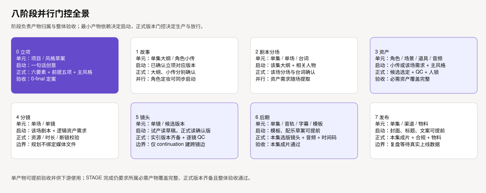
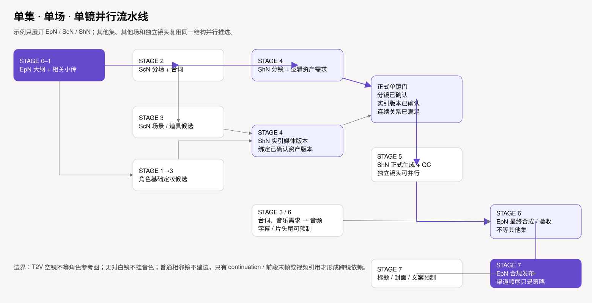
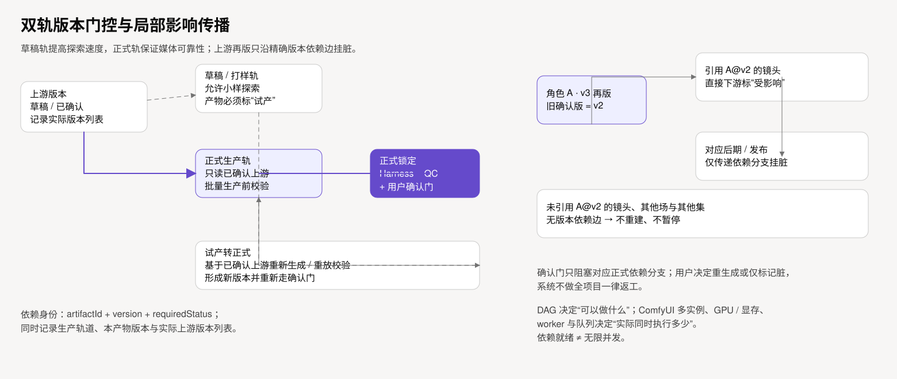
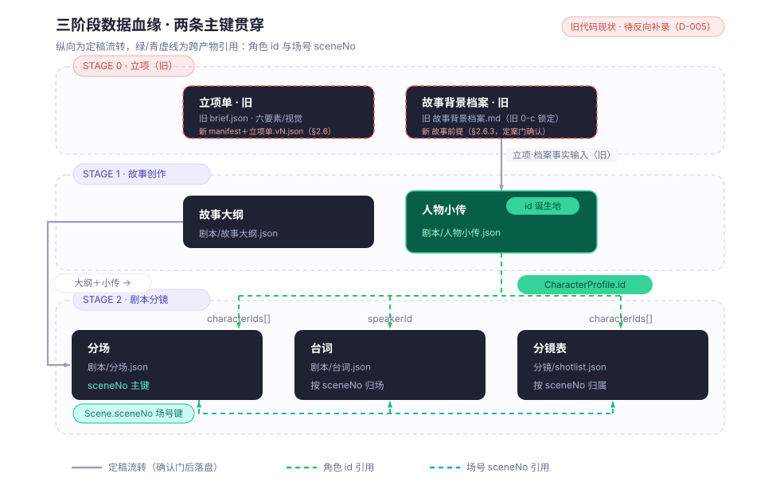

# 短剧 Agent 平台设计

> **定位**：一款全面复刻 MiniMax Design、短剧生产闭环优先的 **AI Agent 驱动内容生产平台**的实现层设计契约（源 · 权威）。本文件是产品与架构的事实源；配套《docs/design/短剧Agent平台-原型.html》（高保真界面原型）。
> 生成自：v1.0（2026-10-02）。**关键决策：完全脱离旧体系**——不沿用 proj.py、旧规范与旧数据结构，产品形态、多 Agent 架构、数据模型全部重新设计。原《AI短剧工作台系统设计》已作废并于 2026-10-09 删除（轨迹见《版本记录.md》）。情报来源见《docs/research/MiniMax Design功能与架构参考.md》。本文件的人读镜像位于 docs/design/ 同名 .html。

## 0. 定位

**产品本质**：一个"理解 → 拆解 → 并行执行 → 审核 → 交付"的短剧生产 Agent 平台。用户只表达创作目标（一句话或一份策划案），**主控 Agent 像导演一样把任务拆给一支虚拟摄制组**——编剧、美术、镜头、声音、引擎各有专职 Agent，它们在同一块画布上并行作业，自动产出剧本、定妆、分镜、镜头、配音、剪辑，直到成片交付。

不是"包一层命令行"，不是"一个聊天框 + 几个模型按钮"，而是：**一块画布 = 一条连续生产线；一个指令 = 一支全能团队**。

**复刻定位（D-034）**：全面复刻 MiniMax Design，短剧生产闭环优先。D-006 的“部分复刻”为历史定位；现行跨 Feature 对账以 [MiniMax Design Parity 影响矩阵](./docs/design/MiniMax%20Design%20Parity影响矩阵.md) 为准，首轮参考基线为《MiniMax Design 功能与架构参考》v1.4。范围映射不等于实现或验收通过。

**目标用户与场景**：

- 个人短剧创作者 / 小型工作室：从灵感到成片不切换工具。
- 批量生产方：模板化、批量化产出多集 / 多版本。
- 优势场景：竖屏短剧、单元剧、系列化 IP、情绪向 / 恋爱向 / 校园向短内容（短、快、强情绪、模板化）。

**与旧体系的关系**：

| 旧体系 | 本平台 |
|---|---|
| proj.py 状态机 + 子进程包装 | 多 Agent 消息总线 + 专职 Agent 协作 |
| 规范 md 为流程事实源 | 平台内置生产工作流 + Skill 体系，规范不再以外部 md 存在 |
| 命令行 check/advance/record | 画布内确认门卡片 + Harness 自动校验 |
| 项目状态.json / 验收规则.json 等旧格式 | 全新数据模型（见 7） |
| 本地脚本 + 人工拼工具 | 本地优先 + 本地/局域网 ComfyUI 统一媒体引擎（H3 Image 图像 / H3 视频 / Music3 音乐，全部权重推理，媒体零公网），一键闭环（v1.7 执行路径，v1.22 / D-033 图像通道修订） |

旧《AI短剧工作台系统设计》v1.1 曾作历史参考，该文档已于 2026-10-09 删除，不再指导开发。

### 0.1 开发原则与边界条件（v1.3 设立，v1.23 现行；2026-10-04 用户拍板，D-034 修订项目必要性）

> 以下六条为本项目立项级原则，是判断"做什么 / 不做什么 / 怎么做"的最高依据；与 AGENTS.md「本项目开发原则」保持一致。

**原则一 · 项目必要性（2026-11-15 用户拍板，D-034）**：**全面复刻 MiniMax Design，短剧生产闭环优先**。覆盖其用户可见功能、核心交互、Agent 工作流、产物语义、任务恢复与版本追溯，同时保留本地 / 局域网 ComfyUI 与完整八步生产体系两类核心差异。按 P0—P7 交付门推进；3D、浏览器、代码 / 网页等完整产品面逐包裁决，账号、团队、社区、积分、支付、云同步默认采用本地替代或经决策不纳入，无真实服务不得伪造在线成功。

**原则二 · 局域网 ComfyUI 硬边界**：引擎层必须支持调用本地及局域网内的 ComfyUI 实例（地址可配置、支持多实例）。这是不可被"云端托管 / 仅本机托管"方案替代的红线；任何使局域网能力失效的设计视为破坏边界。

**原则三 · 八步闭环完整性**：平台必须完整支持我定义的生产体系的 8 步业务闭环，缺一不可，且每一步均有明确产物：

| # | 阶段 | 说明 |
|---|---|---|
| 0 | 立项 | 选题诊断（含六要素口径草案）/ 故事前提（故事背景档案）/ 立项定案卡 |
| 1 | 故事 | 大纲 / 人物小传 |
| 2 | 剧本分场 | 分场表 |
| 3 | 资产 | 角色 / 场景 / 道具资产（资产中心） |
| 4 | 分镜 | 分镜表（镜号 / 景别 / 运镜 / 资产引用） |
| 5 | 镜头 | 逐镜生成与收片 |
| 6 | 后期 | 剪辑 / 字幕 / 合流 / 混音 |
| 7 | 发布 | 成片 / 切片 / 渠道交付 |

> **执行语义（v1.21，D-031 / D-032）**：八步是**产物归属与汇总验收里程碑**，不是“完成一步才能开始下一步”的全局串行启动锁。具体任务按**最小产物依赖 DAG** 调度，STAGE 0–7 均按单产物定义启动、并行、试产、正式门控、两级验收与再版影响边界。后期和发布也按单集下沉，不以其他集完成作为本集合成或上线的前置。八步仍是**业务验收基线**，不允许在实现中合并或裁剪步骤（内部实现可复用同一组件，但用户可感知的阶段产物必须齐备）；某一步整体完成，仍要求该步应交付产物覆盖完整并通过验收（完整矩阵与图稿见 §2.1）。
>
> 现状（2026-11-14）：任务包按八步模块分段编号（0xx–7xx 业务段 + 8xx 平台基础段），已建 30 个，0–2 步已落地（含 feature-201 的 2-c 分镜文字稿，自动化通过、未真机验收），3–7 步完整生产闭环待实施；现存代码与新设计存在偏差处按现行任务包对照本设计对齐重建。当前实现的线性状态与固定编排不视为目标全局锁，目标调度模型见 §2.1 / §7.1。

**原则四 · 继承 + 扩展**：

- **继承（形态对齐）**：MiniMax Design 已具备的功能，其交互形态、流程结构、数据表现直接对齐，保持用户体验一致；底层实现使用其同源开源组件（opencode 运行时、MCP 协议、Skill 格式）自行构建。Design 应用本体闭源，"复用"指形态对齐与开源组件复用，不含其专有代码、商标、私有素材、账号权限或云端服务。
- **扩展（缺口自研）**：Design 缺失的功能（局域网 ComfyUI、八步闭环中 资产/镜头/后期/发布 等）针对性自研扩展，并通过功能溯源标签 **[Design 原有] / [改编] / [自研新增]** 逐条标明来源，保证每个功能点可判定归属。
- **逐包验收**：全面复刻不等于建立一个“大复刻包”；完整产品面逐包裁决，所有能力仍须逐 Feature 建包、逐条对账、逐项验收或经决策不纳入。

**原则五 · 生成通道红线（2026-10-04 用户拍板，v1.7 补执行路径终局，v1.22 / D-033 修订图像通道）**：平台生成通道固定，不做多模型矩阵：

- **图像：仅 MiniMax H3 Image**；
- **视频：仅 MiniMax H3**（本地 / 局域网 ComfyUI 工作流）。

- Agent 不得自行选择或切换到其他图像 / 视频模型；Design 的云端多模型矩阵（海螺 / 可灵 / Veo3 / Wan / seedream / Midjourney 等）在本项目中**不沿用**。
- **音乐：仅 MiniMax Music3**。
- 语音（TTS / 声音克隆）通道暂未限定，待后续决策。
- **执行路径（v1.7 终局，D-010；图像模型由 D-033 修订）**：图像 / 视频 / 音乐三类媒体生成**全部经本地 / 局域网 ComfyUI 执行**——H3 Image、H3、Music3 均为**本地 / 局域网权重 / 工作流推理，纯局域网、不出公网、无按次云费用、无媒体类云端 API Key**；H3 官方工作流内部指定的文本编码器是 H3 组件，不构成 Qwen-Image 生成通道回退；ComfyUI 是统一媒体引擎（复用 B0/B5/B8/B9 工作流模板）。文本服务固定火山方舟 / LM Studio 二选一（D-021 / D-022）：选择火山方舟时仅文本调用出公网，选择本地 / 局域网 LM Studio 时文本亦可在本地 / 局域网完成。renderer 不直连 ComfyUI，媒体调用一律收敛于 MCP / 主进程引擎工具。

**原则六 · 系统优先，AI 归位（2026-10-16 用户拍板，D-016）**：本平台是**系统承载、AI 辅助**的桌面应用——AI（Skill / 对话）只是处理文本内容的工具，不是交互主体。

- **确定性操作系统直做**：文件读写、字段编辑、版本管理、状态推进、规则可枚举的推算（如立项字段改动的影响追溯），凡系统以确定性逻辑即可完成者，一律由 UI 操作直调系统能力完成，**不经 AI 对话**——更快、更省 Token、结果可复现。
- **AI 仅承担文本生成与开放式语义理解**：故事 / 剧本 / 分镜等文本创作、选题诊断、大白话意图解析等无确定规则的任务，才走 Agent 对话通道。
- **判定标尺**：「这个操作能否写成枚举规则 / 表单校验？」能 → 系统做；不能（需生成或理解开放文本）→ AI 做。
- **双通道并存时的取舍**：系统直改为默认入口（面板 / 按钮 / 表单），对话入口保留为开放式修改（大白话）的兜底；两者产出须落**同一数据模型与同一追溯机制**（如立项修改：面板直改与对话修改均再版 brief、走同一影响评估与画布挂脏）。

> 与 D-010 / D-021 终局自洽：选择火山方舟时出公网仅余文本调用，选择本地 / 局域网 LM Studio 时文本亦可不出公网，AI 成本集中于文本；§2.6.7 影响评估是确定性追溯算法，已实现为系统 MCP 工具（brief.impact.assess / commit）——连「改字段影响谁」都无需 AI 推算。

### 功能溯源图例

本文每个功能点均标注来源，便于区分「照抄 MiniMax Design」「在 Design 基础上为短剧改造」「短剧专属自研」三类：

| 标签 | 含义 | 来源依据 |
|---|---|---|
| **[Design 原有]** | MiniMax Design 已有功能，本平台直接沿用形态 | 官方手册 / 官网 / 架构实测 |
| **[改编]** | Design 有此能力，但为短剧场景做了改造（角色、流程、数据结构等） | 对照 Design 后重设计 |
| **[自研新增]** | Design 没有，为本平台短剧生产专门新增 | 短剧专属决策 |

> 对照源：《docs/research/MiniMax Design功能与架构参考.md》（功能全景 §1、架构实测 §2、对照 §3）。

## 1. 设计原则

| # | 原则 | 内容 | 来源 |
|---|---|---|---|
| 1 | 系统承载，AI 辅助 | 确定性操作由系统直做，AI 仅承担文本生成与开放式语义理解；系统直改为默认入口，对话为开放式兜底，双通道共用数据模型与追溯机制 | [改编]（D-016） |
| 2 | 画布即真相 | 全部产物与过程在一块画布上可见，节点自动连线，数据流即视觉 | [Design 原有] |
| 3 | 人是导演，不是操作员 | 人只在关键节点做方向决策（确认门）；不做参数搬运、文件拼接 | [改编]（Design 有审核节点，本平台将其明确为唯一人工阻塞点） |
| 4 | 产物依赖驱动并行 | 编剧 / 美术 / 镜头 / 声音 / 引擎各有专职；主控 Agent 按最小产物依赖 DAG 拆解与合流，草稿试产与正式生产实行双轨版本门控，STAGE 0–7 的无依赖任务均可跨阶段并行，单产物验收与阶段整体验收分离 | [改编]（Design 为 router/planner/executor/media-agent/comfyui-agent，本平台改为短剧摄制组角色；双轨门控为 D-031 自研扩展，八阶段完整基线为 D-032） |
| 5 | 经验可复用 | 一次跑通的过程可沉淀为 Skill；Skill 可分享、可一键复用 | [Design 原有] |
| 6 | 本地优先 | 素材与项目默认存本地；文本服务固定火山方舟 / 本地或局域网 LM Studio 二选一；媒体经本地 / 局域网 ComfyUI 零公网生成；云端 Key 由 safeStorage 加密存于 userData，不可加密即拒绝保存 | [Design 原有] |
| 7 | 质量内建 | Harness 层在后台加载领域知识、多轮机器校验；不通过则进不了确认门 | [Design 原有] |
| 8 | 克制的画布自由 | 画布以"自动布局 + 视觉整理"为主，不做无约束自由编排，避免复杂度失控 | [改编]（Design 画布自由度较高，本平台明确收敛） |

## 2. 五段式使用体验与八步生产依赖

对齐 MiniMax Design 的连续创作链路，按短剧生产重构：

```
① 灵感输入          ② 画布编排          ③ 方法复用
 AGENT MODE    →    CANVAS FLOW   →    SKILL READY
 一句话/一份案       剧本·定妆·分镜·     专属 Skill /
 主控 Agent 拆解     镜头·声音·剪辑      广场工作流
 产出创意简报        全在一块画布         专业插件
        ↓                                       ↓
④ 本地衔接          ⑤ 审核交付
 LOCAL BRIDGE   →   REVIEW LOOP
 资产中心 / 本地     方向确认门 / Harness
 文件 / 专业工具     多轮校验 / 成片交付
```

1. **[改编] 灵感输入**：自然语言描述目标（"做一部校园恋爱短剧，女主大一新生，夏天的海边小城，每集 90 秒，先做第一集"）或丢入策划文档；主控 Agent 理解意图，产出**创意简报**（题材 / 人设 / 集数 / 时长 / 画幅 / 风格）与**任务地图**（DAG）。Design 的"创意简报 + 任务拆解"结构直接沿用，简报字段为短剧定制。
2. **[改编] 画布编排**：编剧出剧本与分场，美术出角色 / 场景资产，镜头 Agent 逐镜生成，声音 Agent 出配音与配乐，剪辑 Agent 合流——全部节点自动连线落画布。Design 原画布形态沿用，节点类型按短剧生产链重排。
3. **[Design 原有] 方法复用**：可调用 Skill 广场的成熟工作流（如"强情绪三连镜""日漫定妆流"），可挂载专业插件（3D 导演台、批量水印等）。
4. **[Design 原有] 本地衔接**：资产中心统一管理本地素材；画布产物自动本地化；支持外部专业工具导出 / 导入。
5. **[改编] 审核交付**：每个关键节点 Agent 主动发起方向确认；Harness 后台多轮校验；通过后交付成片与切片。Design 的"审核节点 + Harness 校验"沿用，确认门触发点按短剧阶段（简报/定妆/分镜/整集/成片）设定。

### 2.1 八步里程碑、产物依赖 DAG 与双轨版本门控 [改编]（v1.21，D-031 / D-032）

八步业务闭环回答“**产物归属哪个阶段、该阶段何时整体验收完成**”，不回答“所有任务必须按什么顺序启动”。主控 Agent 与系统调度器以具体任务的最小产物依赖建图：只有真实依赖未满足的任务等待，无依赖或依赖已满足的任务可跨 STAGE 并行；用户也可直接对任一已就绪任务发起操作，不必先切换或解锁其所属 STAGE。

#### 八阶段并行门控全景

调度单位下沉到项目、单集大纲、单角色小传、单资产、单场、单镜头、单条音轨、单集后期和单渠道发布包。**依赖就绪与资源调度分离**：DAG 决定「可以做什么」，ComfyUI 多实例、GPU / 显存、worker 与队列决定「实际同时执行多少」；依赖就绪不等于无限并发，也不等于自动正式生产。



可编辑总图：[Whiteboard HTML](./docs/design/diagrams/八阶段并行生产设计图.html) · [Excalidraw 源](./docs/design/diagrams/八阶段并行生产设计图.excalidraw)。三张 SVG 与总图使用同一组图元定义，供 A / B 类文档直接阅读。

#### STAGE 0–7 完整启动、并行、验收与再版矩阵

| 阶段 | 最小调度与验收产物 | 真实硬依赖 | 可提前准备 / 并行工作 | 草稿试产 → 正式生成 / 锁定 / 放行 | 单产物验收 vs 阶段整体验收 | 上游再版的精准影响 |
| :-- | :-- | :-- | :-- | :-- | :-- | :-- |
| **0 立项** | 项目立项单、选题诊断、故事前提、主视觉风格草案；项目级 `0-final` | 用户创意与诊断所需资料；正式基线须具备六要素、故事前提五项和主风格 | 选题诊断、故事前提、主视觉风格草案可并行收敛，不等完整剧本 | 草稿可供故事与风格探索；正式下游基线只读经用户确认的 `0-final` | 诊断、前提、风格草案可分别确认；STAGE 0 完成须正式产物齐备并通过 `0-final` | 核心前提 / 主风格再版只影响显式引用对应立项版本的下游；普通元数据修改不触发生产链返工 |
| **1 故事** | 单集大纲、单角色小传及其确认版本 | 对应立项版本；单集大纲依赖故事前提，角色小传依赖相关人物设定 | 各集大纲、各角色小传可分校验并行推进；基础角色定妆只需相关小传与主风格，可与剧本分场并行 | 草稿大纲 / 小传可供剧本或定妆试产；正式该集剧本读已确认该集大纲，正式角色定妆读已确认该角色小传与主风格 | 单集大纲、单角色小传可分别确认并供下游；STAGE 1 完成仍须全剧必需集与角色覆盖完整 | 角色小传再版影响该角色资产及显式引用版本的剧本 / 分镜 / 镜头；单集大纲再版只影响该集显式下游 |
| **2 剧本分场** | 单集剧本、单场分场、单场台词、随场提取的资产需求项 | 该集大纲及该场涉及的人物小传 | 独立集、独立场并行；分场、台词和资产需求随场推进；基础资产先行，特殊服装 / 场景 / 道具需求后补 | 草稿可供分镜、资产需求与配音草案试产；正式对应分镜、资产和音频任务只读该场已确认分场与台词 | 单场确认即可供对应下游；STAGE 2 完成须全集、全场及必需台词覆盖完整并通过整体验收 | 单场再版只影响该场资产需求、分镜、音频及其传递下游，不误伤其他场 |
| **3 资产** | 单角色 / 场景 / 道具 / 音频资产及其候选、正式版本 | 角色基础定妆依赖小传与主风格；场景 / 道具依赖对应场需求与主风格；音频依赖台词或音乐需求；生成依赖可用 ComfyUI 实例、权重与工作流 | 角色、场景、道具、音频四分支并行；逻辑 ID、提示词、候选小样和实例探活可提前 | 草稿设定可生成试产小样；正式媒体生成只读已确认设定与主风格；候选选定、QC、人工锁定后形成正式资产版本，实引该版本方可放行 | 单资产锁定后可被实际引用；STAGE 3 完成须必需资产覆盖完整，未被某镜引用的候选不阻塞该镜 | 某资产某版本再版只挂脏实际引用该版本的分镜绑定 / 镜头及传递下游；未引用节点继续执行 |
| **4 分镜** | 单场分镜、单镜头规划、逻辑资产绑定、提示词、生成模式、时长与连续关系 | 该场已确认分场 / 台词及逻辑资产需求；实际媒体文件只在生产前校验；T2V 空镜无角色参考硬依赖 | 独立场、独立镜并行；可先绑定逻辑 ID、T2V / I2V / R2V 模式、提示词和时长，不等全部资产成图 | 草稿可供分镜预览与打样规划；正式生产门校验该镜分镜已确认、实引资源版本齐备、时长合理、绑定不断链、连续关系满足 | 单镜规划可分别确认并进入生产准备；STAGE 4 完成须必需镜头覆盖完整并通过连续关系整体验收 | 单镜分镜再版只影响该镜生产及其后期分支；连续关系变更只影响显式关联镜头 |
| **5 镜头** | 单镜生成任务、候选视频版本、QC 与选版 / 收片记录 | 该镜已确认分镜、实引媒体正式版本和可用 ComfyUI 资源；`continuation` 另依赖前段选定末帧 / 视频 | 独立镜头与多候选打样并行；普通相邻镜头没有天然先后依赖，不建立跨镜边 | 草稿依赖可生成标记为「试产」的候选；正式生成只读已确认上游与实际媒体版本；逐镜 QC、用户选版 / 收片后形成正式镜头版本 | 单镜选版即可进入所属单集后期；STAGE 5 完成须全剧必需镜头正式选版，但单集后期不等全剧镜头齐 | 选版镜头再版只影响所属单集后期与发布；被 `continuation` / 前段引用时，才传递影响显式后续镜头 |
| **6 后期** | 单集剪辑工程、字幕、音轨、调色 / 片头片尾模板、单集成片版本 | 最终合成依赖本集选版镜头、正式音频和实际时间码；模板与草案准备不依赖全部镜头 | 配乐草案、字幕模板、片头片尾、剪辑工程和调色测试可提前；各集后期并行 | 草案可预演；定时字幕、最终混音和最终合成只读本集正式选版及实际时间码；本集成片经 QC 与用户验收后锁定并放行发布 | 单条字幕 / 音轨 / 模板可分别验收，本集成片可独立验收；STAGE 6 完成须计划内全集正式成片齐备 | 本集后期再版只影响本集发布包；模板 / 音乐再版只影响显式引用项，不反向挂脏无关镜头 |
| **7 发布** | 单集发布包、单渠道物料、发布记录与复盘数据 | 上线依赖本集成片验收、合规通过和对应渠道正式物料；复盘依赖真实上线数据 | 封面、标题、简介、渠道文案和发布计划可提前；多渠道、多物料、独立单集并行 | 物料草稿可预审；正式发布只读已验收成片、合规结论与正式物料，经用户确认渠道和时间后放行 | 单物料、单渠道包可分别验收，本集可独立发布；STAGE 7 完成须计划内集 / 渠道完成并取得应有复盘 | 发布物料再版不反向挂脏制作上游；成片再版只影响对应集 / 渠道发布包；发布顺序只是渠道策略，不是制作依赖 |

**门控与验收的六个判定**：

- **可提前准备**：可建立逻辑 ID、模板、提示词、需求与草稿，不代表允许正式媒体生成。
- **草稿试产**：可读取已声明依赖的草稿或已确认版本，产物必须标记「试产」，不得冒充正式版本。
- **正式生成**：该任务实际读取的上游、媒体、权重 / 工作流与生成参数均满足正式门；仅就绪不自动触发批量生产。
- **正式锁定**：本产物形成新正式版本，并通过 Harness / QC 与用户确认门；试产转正式须重新生成或执行等价重放校验，不能只改状态。
- **单产物验收**：某一集、场、角色、资产或镜头可独立确认并供其下游使用，不被同阶段其他产物阻塞。
- **阶段整体验收**：STAGE 完成仍要求所属必需产物覆盖完整、正式版本齐备且整体验收通过；它是汇总里程碑，不反向变成全局启动锁。

#### 单集、单场、单镜主流水线



- 文本主路径按 `EpN → ScN → ShN` 前进，其他集、场和独立镜头复用同一结构并行推进。
- 角色基础定妆从相关小传与主风格分支启动；场景 / 道具从对应场需求分支启动；两条资产分支在该镜实际引用处合流。
- 普通相邻镜头不建依赖边；只有 `continuation`、前段末帧 / 视频引用等显式关系才建立跨镜依赖。
- 后期与发布均按单集下沉，`EpN` 成片验收与合规发布不等待其他集，避免末端重新形成全剧串行锁。

#### 关键任务最小前置速查

下表描述**正式任务**的最小前置；草稿试产可按双轨规则使用对应上游草稿。依赖粒度应细到角色、场景、场次、镜头或单集，不以整个 STAGE 为前置单位。

| 任务 | 最小前置 | 明确不必等待 |
|---|---|---|
| 角色概念 / 定妆 | 主视觉风格 + 该角色身份、年龄、外貌、基础服装等人物设定；正式定妆前该角色概念方向已选定 | 完整剧本、完整分场、其他角色定妆 |
| 剧本分场 | 故事大纲 + 人物设定 | 角色 / 场景图片全部完成 |
| 场景 / 道具 | 主视觉风格 + 对应场次的场景 / 道具需求 | 全剧所有分场完成、其他场景 / 道具完成 |
| 分镜文字稿 | 对应场剧本 / 分场 + 所需资产的逻辑 ID / 引用需求 | 全部资产图片出完、其他场次分镜完成 |
| 单镜头生成 | 该镜分镜已确认 + 该镜实际引用的资产版本已确认 / 锁定 | 其他镜头、其他集全部完成 |
| 后期准备 | 相应创作口径；配乐、字幕模板、片头片尾与剪辑工程可分别按自身依赖提前开始 | 全部镜头完成后才开始准备 |
| 发布物料 | 相应项目 / 单集口径；封面、标题、简介、渠道文案可提前制作 | 成片完成后才开始准备 |
| 最终合成 / 发布 | **本集**所需镜头、音频、字幕齐备且成片验收通过 | 其他集全部完成 |

故事大纲为角色设计提供气质方向，但不是每张定妆照的独立硬输入；基础定妆消费该角色的人物设定与主视觉风格，特殊剧情服装可按对应场次后补，不阻塞基础定妆。分镜只绑定资产逻辑 ID / 引用关系，不等待图片文件全部生成；真正消耗图片、视频或音频文件的任务，才绑定具体媒体版本。STAGE 3 的整体完成仍要求全剧资产覆盖完整并通过验收，但单个资产可提前制作、验收与锁定。

#### 双轨版本门控与局部影响传播

| 轨道 | 可读取的上游 | 用途与产物标记 | 放行边界 |
|---|---|---|---|
| 草稿 / 打样轨 | 已声明依赖的上游**草稿或已确认版本** | 用于探索、方向比较与小样；产物及任务必须显著标记“试产”，保留草稿血缘 | 不得冒充正式资产，不得直接进入正式合成 / 发布 |
| 正式生产轨 | 仅已确认的上游版本 | 用于正式生成、批量生产与正式锁定 | 每个任务记录精确版本依赖，经 Harness 与确认门后方可作为正式下游输入 |



草稿试产产物若需转正式，不得只改状态标记；必须基于已确认上游版本重新生成或重放校验，并重新走正式确认门。任务依赖至少记录 `artifactId + version + requiredStatus`，同时记录本任务轨道与产物版本；正式任务的 `requiredStatus` 必须指向可正式消费的已确认状态。缺料时明确报告缺少哪个产物、哪个版本或哪种确认状态，不静默降级，也不把“阶段未完成”笼统当作缺料。

#### 阶段汇总与局部影响

STAGE 状态是其所属任务的**汇总结果**，不是其他任务的统一启动锁：

| 阶段汇总状态 | 含义 |
|---|---|
| 未开始 | 尚无该阶段任务或产物 |
| 进行中 | 至少一个所属任务已启动，且尚未满足整体验收条件 |
| 待验收 | 该阶段必需产物已齐备，等待阶段整体验收 |
| 已完成 | 必需产物覆盖完整，正式版本与整体验收均通过 |
| 部分受影响 | 上游再版使部分已交付产物失效或待对齐，其余产物仍可继续推进 |

上游再版后，系统沿精确版本依赖边只挂脏直接及传递引用该版本的下游产物；未引用该版本的任务、其他角色 / 场次 / 镜头 / 单集及无关节点继续推进，不再把整个 STAGE 3–7 一并打回。受影响范围、重生成与人工确认均落到同一依赖图和事件追溯机制。

### 2.6 立项阶段（STAGE 0）详解 [自研新增]

> 本节经《2002 相识》立项流程对话推演（2026-10-08）重写，取代旧版「4 节点（创意输入→选题诊断→立项单→故事背景档案）+ 4 确认门（0-a~0-d）」模型；旧模型与真实生产实践不符，已随 D-005 作废。

**立项阶段目标**：通过对话收敛三件事——**口径**（六要素：做什么、在哪发、多长、什么形态）、**故事前提**（时间 / 地点 / 人物 / 核心事件 / 边界）、**视觉风格**（1 个主风格 + 可选 1 个辅助气氛），形成供正式下游读取的 `0-final` 立项基线。该基线不是 STAGE 1 或其他阶段的全局启动锁，具体任务仍按 §2.1 的最小产物依赖 DAG 就绪。立项不是填一张多 tab 表单，而是一段持续收敛的对话；界面只做两件事：随时呈现已捕获的内容、在就绪时给出一键定案。

**总体模型：1 个入口动作 + 2 个节点 + 1 道定案门**

```
[一句话创意]  →  ① 选题诊断         →  ② 故事前提       →  🚪 立项定案门
  入口动作        （含六要素口径草案）    （背景档案·对话收敛）   就绪即发定案卡
   ↘ 反问关键分叉（商业短剧 / 个人纪念）                         一键 / 口头拍板
   ↘「已捕获口径」区从第一句话起持续可见、随时可改
```

一句话创意只是**入口动作**，不占节点；节点之间不是严格的单向门——用户随时可以回到任何已捕获内容上修改，Agent 在对话中同步更新。

#### 2.6.1 入口：一句话创意与反问机制

用户说出一句话创意（如「我想做一个我和我老婆认识的故事，发生在 2002 年」）后：

1. **Agent 先反问关键分叉**，不直接开干。第一问是项目性质：**商业短剧**（要上平台，讲打法、合规）还是**个人纪念**（不以投放为目的）？这一问决定选题诊断与六要素草案的方向。
2. **未回答前，能记录的先记录**。从创意中可直接提取的事实（时间=2002、核心事件=相识、人物关系=夫妻）立即写入「已捕获口径」区，不等用户回答反问。
3. 用户回答后（如「商业短剧」），Agent 带着补充口径进入节点①。

**「已捕获口径」区**：立项界面的常驻区域（对话区旁 / 画布侧栏），从第一句话起持续累积；每条口径标注来源（用户原话 / Agent 推断待确认），用户随时可直接修改或在对话中纠正。它是两个节点与定案卡的共同数据源，不是某个节点的专属产物。

#### 2.6.2 节点①：选题诊断（含六要素口径草案）

主控 Agent 基于已捕获口径检索同赛道公开数据，产出**选题诊断卡**；商业短剧与个人纪念走不同详略：

| 区块 | 内容 | 个人纪念口径 |
|---|---|---|
| 同赛道对标案例 | 案例名 / 平台 / 成绩 / 打法 / 启示 | 弱化为风格参考 |
| 用户洞察 | 赛道用户迁移方向 | — |
| 爆点 / 钩子模式库 | 先婚后爱 / 明撩暗撩 / 日常治愈 / 双向救赎 + 钩子工程 | 不强制 |
| 合规风险 | 备案分级、AI 融像 / 融声授权、平台审核 | 仅提示私人影像使用边界 |
| 结论 | 可做 / 不可做 / 需调整 + 打法与集数区间 | 直接判「可做」 |

诊断产出的同时，Agent 给出**六要素口径草案**（全部预填、全部可改，不再设独立的多 tab 立项单审批）：

| 要素 | 说明 | 2002 相识案例（纪念倾向） |
|---|---|---|
| 题材赛道 | 如「都市爱情（女频）」 | 青春 / 爱情·年代纪念 |
| 目标平台 | 抖音 / 小红书 / 红果，含定位（投流 / 种草 / 切片） | 待定（纪念用途） |
| 单集时长 | 建议主力时长 | 待定 |
| 集数 | 以内容定或设区间 | 待定 |
| 风格基调 | 故事氛围基调（叙事层，进情绪 / 氛围类提示词） | 千禧清新怀旧 · 温馨（2002 年年代氛围） |
| 画幅 | 按平台规则派生，必填 | 待定 |

**风格是两个维度，互不替代、都影响下游提示词**：
- **风格基调**（上表，叙事层）：故事氛围基调，Agent 按故事内容定（如「千禧清新怀旧 · 温馨」），进情绪 / 氛围类提示词（分镜情绪、场景氛围）；
- **视觉风格设定**（画面层，纳入 `0-final` 定案版本，见 §2.6.4）：形态 × 主画风 × 质感配方 × L2 锚词，必须从《视觉风格谱系》选取，进概念稿 / 定妆 / 场景提示词 Base。

> 对齐《安妮的夏天》立项单 v3 口径：v1 风格基调（千禧清新怀旧 · 温馨）保留为故事氛围基调；v2 新增视觉风格设定（仿真人 · 拟真人·仿真人动漫 + 质感配方 euler / normal 20 步 CFG 2.5 + 锚点词），两者并存。

用户的处理方式是「看诊断 + 看草案，有倾向就让 AI 再调，具体要改什么直接说」——可以只改六要素，也可以只追故事前提，顺序自由。

#### 2.6.3 节点②：故事前提（故事背景档案的形成方式）

故事前提不是 STAGE 1 的完整故事，也**不是让用户填模板**，而是进入故事创作前的准备性事实：**时间、地点、人物基本信息、核心事件、本季边界**。它以对话收敛的方式形成，沉淀为「故事背景档案」——人提供（或确认）的原始事实，是后续编剧的不可篡改依据。

Agent 的两种工作方式：

- **信息相对全**：Agent 先编一个「假的」前提版本（合理虚构的人物身份、相遇场景），用来引出真人真事；用户照着纠正即可，不必从零组织语言。
- **信息不全**：Agent 先问几个关键事实（主角是谁、多大、在哪、怎么遇上的），再动笔。

**故事前提最低门槛（暂定，开发中发现不够再议）**：

| # | 项 | 最低要求 |
|---|---|---|
| 1 | 人物 | 主角身份 / 年龄（双方） |
| 2 | 时间 | 故事发生时间（如 2002 年） |
| 3 | 地点 | 故事发生城市 / 环境 |
| 4 | 核心事件 | 相遇方式一句话 |
| 5 | 边界 | 本季讲到哪（如第一季只讲相识） |

《安妮的夏天》实测事实即此形态：林夏 19 岁学金融不住校、陈默 22 岁父母离婚随父、单位距林家 2–3 公里、第一季 = 相识（01–11 集）。

#### 2.6.4 视觉风格设定：双维度中的画面层

**立项信息的风格由两个维度构成**（见 §2.6.2）：**风格基调**（叙事层，六要素之一，进情绪 / 氛围提示词）与**视觉风格设定**（画面层，本节）。本节只讲视觉风格设定；它和风格基调互不替代——基调决定"讲什么氛围"，视觉风格决定"画面长什么样"，两者都写入下游提示词（基调进情绪 / 场景氛围词，视觉风格进概念稿 / 定妆 / 场景提示词 Base）。

视觉风格设定必须从系统级外部数据库《AI短剧制作视觉风格谱系》中选取（见 §8.3），**Agent 不得凭印象自创画风**——谱系条目的历史预览可由 Qwen-Image 或 MiniMax H3 产生，原始媒体与内嵌参数继续作为证据保留；现行新增图像仅使用 MiniMax H3 Image（D-033），不重写历史来源。Agent 先按题材匹配一个，人可以改，立项后也可以改；改风格后，系统沿真实字段引用与精确版本依赖精准挂脏，由用户决定受影响分支重新生成或仅标记脏，不做全链路提示词一律重出。

选型模型是三条正交的轴：

| 轴 | 取值 | 语义 |
|---|---|---|
| **使用角色轴** | 主风格 ×1 | 全片唯一，= 家族 + 具体风格；任何时刻仅 1 个，后期可换但不能并存 |
| | 辅助风格 0–1 个 | 按剧情需要挂的「**气氛**」（如都市剧挂悬疑气氛）；不挂亦可 |
| **验证状态轴**（谱系内标记） | 「主」 | 被真实项目（安妮的夏天）验证跑通的条目（11 项） |
| | 「备」 | 已登记但未经项目验证的主风格候选（7 项）；主风格候选含全部主 + 备条目，选「备」风险自担（可能出不来效果） |
| **形态轴** | A 写实影像 / B 青春治愈 / C 卡通 / D 类型氛围 等家族 | 仅用于谱系归类与检索 |

**辅助风格候选域封闭**：只能从 **B 青春治愈系（1 项：清新生活流）** 与 **D 类型氛围系（5 项：冷调悬疑 / 赛博科幻 / 神话国风为「主」，奇幻童话 / 暗黑哥特为「备」）** 中选取。辅助挂的是跨形态的气氛，不改变主风格的画风归属。

> 注意：谱系只管**画风**。年代（2002）、地域等事实作为**内容**进入提示词，不作为选择画风 ID 的依据（如「2002 年」不必然推出「年代胶片」画风）。

项目数据中的风格引用记录为「**风格 ID + 谱系版本**」（如 `A7 @ v1.46`）；当前谱系版本 v1.46（2026-11-13；上一版 v1.45 / 2026-10-01）。

#### 2.6.5 定案门：就绪判定与立项定案卡（v1.10 语义修订）

立项只有**一道**门，是就绪条件的客观判定，不搞逐产物审批。**门后字段仍可改**（见 §2.6.6），定案门的本质是"**当前版本的落定**"，不是"灵魂边界"。

**就绪条件（全部满足）**：

1. 六要素均有取值（「待定」视为有值，但在定案卡上显式标注，由用户确认接受）；
2. 故事前提达到最低门槛（5 项）；
3. 已选定 1 个主风格。

满足后 Agent 主动发出**立项定案卡**：

```
┌─ 主控 Agent · 立项定案卡 v(N+1) ───────────────────────┐
│ 六要素：青春爱情·纪念向 / 平台待定 / 时长待定 /        │
│        集数待定 / 年代胶片（千禧·90s·80s）/ 画幅待定    │
│ 故事前提：2002 · 某城 · 男女主身份年龄 · 相遇方式      │
│ 主风格：A3 年代胶片（千禧·90s·80s） @ v1.46（备：未经项目验证） │
│ 辅助风格：D 冷调悬疑气氛（可选）                       │
│                                                       │
│ 相对 vN 改动：集数 8→10、风格 A7→A3（影响评估见下）     │
│                                                       │
│ [发布立项 v(N+1)]  [再改改]  [查看历史]                │
└───────────────────────────────────────────────────────┘
```

- **一键拍板**：点「发布立项 v(N+1)」→ 立项单 `立项单.v(N+1).json` 落盘，旧版 vN 留底，形成供已就绪下游读取的 `0-final` 正式基线；不构成 STAGE 1 或其他阶段的全局启动锁。
- **口头拍板等价**：用户在对话里说「行，开始讲故事吧」等同拍板；系统记录**用户原话**与定案卡（立项单）版本号，效果与按钮完全一致。
- 未就绪时 Agent 不发定案卡，而是明确指出缺什么（如「还差故事边界：这季讲到哪？」）。
- **跨版本改动提示**：定案卡中显式列出"相对上一版本的改动"与"影响产物清单"（见 §2.6.7），让用户在拍板前就看到下游代价。
- **历史回溯**：所有历史版本（v1..vN）永久保留，支持 diff 视图与任意版本回滚（回滚 = 当前版本再发一版，内容 = 选中历史版）。

#### 2.6.6 立项后的变更：全字段可改 + 影响评估 + 用户决策（v1.10 升级）

> v1.9 的"反补机制"将立项视为半锁定（核心 premise 不可改），v1.10 经用户拍板（2026-10-09）改为**全字段可改 + 影响评估**——立项不再有"灵魂边界"，所有字段（含 premise）任何阶段都可改；改后系统标记下游影响点，由用户决定是否重生成。决策记录见 D-011。

**核心三原则**：

1. **全字段可改**：L0（项目名 / 标签 / 备注）、L1（集数 / 时长 / 受众 / 基调 / 画幅）、L2（故事前提 / 主风格）任何字段在 STAGE 0–7 任何阶段都可改。无 disabled、无锁形 icon。项目标题由系统经 `.session.json + project:rename` 直改，不进入 Agent 生成类传播（D-020）。
2. **影响必标记**：每次保存（落盘新版本 v(N+1)）时，系统按 `manifest.json`（当前 brief 影响评估实现）的依赖图反向追溯所有**已生成且真实引用了被改字段与对应版本的下游产物**，列入"待对齐清单"；目标通用版本 DAG 的数据模型见 §7.1。
3. **决策归用户**：受影响产物**不自动重生成**；再版、影响清单与脏标记在保存时先行落盘，用户再从"一键重生成选中 / 仅标记脏"两个业务动作中选择，也可关闭面板暂不处理。关闭面板不撤销再版。保留旧确认版的产物可继续查看、编辑和草稿探索；正式生成必须满足 §2.1 双轨门控，显式沿用旧确认上游时须记录实际 `artifactId + version + requiredStatus` 与不一致提示，不得以"运行时照常"绕过正式门。

**触发入口**（在 STAGE 0 步骤内的 v1.9 立项视图中可改；也支持在 STAGE 1+ 通过对话提出）：

- **v1.9 立项视图**：所有 L0/L1/L2 字段可编辑，底部"发布立项 v(N+1)"按钮（取代旧"立项完成"按钮的锁死语义）。
- **对话方式**：用户说"把集数改成 12 集" → Agent 改字段并提示"已记录，将在下次发布时落盘 v(N+1)"，用户口头/按钮拍板等价。
- **流程导航快捷入口**（方案 A 左栏流程导航分区）：点 STAGE 0 步骤进入 v1.9 视图，步骤旁显示当前版本号 + 待对齐计数（`✓ v3` / `v1 ⚠️2`）。
- **生产中实测反补**：STAGE 3 资产规格不符、STAGE 4 分镜时长不匹配等实测问题，可在产出节点旁"反补到立项"按钮发起变更。

**字段改动与影响范围映射**（目标口径；当前 brief 专用实现快照见 §2.6.7，项目标题边界以 D-020 为准）：

| 字段分类 | 字段举例 | 可能影响的下游产物 |
|---|---|---|
| 项目标题 / 标签 / 备注 | `title` / `tags` / `notes` | 标题由系统直改且不进入 Agent 生成类传播；标签 / 备注仅元数据，不下钻生产链 |
| 集数 | `集数` | 计划集清单及各集大纲 / 分场 / 后期 / 发布的覆盖范围 |
| 单集时长 | `单集时长` | 对应集剧本与分场节奏、分镜时长预算、后期时间线；不直接等同单镜头时长或轨道数 |
| 画幅 / 比例 | `画幅` | 显式引用该画幅版本的资产规格 / 镜头分辨率 / ComfyUI 工作流参数 |
| 受众 / 题材 | `题材` / `受众` | 显式引用对应字段的主控 Agent 提示词 / 选题诊断案例 / 视觉风格选型 |
| 主风格 | `主风格` | 显式引用该风格版本的提示词 base / 资产风格 / 镜头色彩分支 |
| premise 核心 | `故事前提` 任意子项 | 显式引用对应 premise 字段与版本的故事 / 分场 / 角色 / 分镜等分支 |

**"待对齐"语义**：

- 产物节点挂角标 ⚠️"基于 vN，与 v(N+1) 不一致"，hover 显示"哪个字段与新版本不符"。
- 节点不丢、不灰显，用户可继续查看、编辑和草稿试产；正式生成 / 正式锁定必须按 §2.1 校验已确认上游及精确版本，不再一律脏读放行。
- 当前 brief 实现保留 `parentReference: { briefVersion: vN }` 并显示不一致提示；目标通用模型同时记录实际 `artifactId + version + requiredStatus`，沿用旧确认版必须是可审计的显式选择。
- 一次重新打开产物编辑 = 触发"是否按 v(N+1) 重新对齐"二次确认；确认对齐后须按实际上游版本重新生成或重放校验，不能只改版本标签。

**历史版本与回滚**：

- 立项单全量保留 v1..vN，对应文件 `立项单.vN.json`（项目根，每次发布生成一份，永不覆盖）。
- "查看历史"按钮：左右两栏 diff 视图（vN vs v(N+1)）+ 任选历史版回滚。
- 回滚 = 新发一版 `立项单.v(N+1) = 立项单.vK 的内容`；保留全部历史。

**STAGE 0 步骤的视觉**（方案 A 左栏流程导航 + titlebar 进度轨）：

| 状态 | 流程导航步骤显示 | titlebar 进度轨步骤显示 |
|---|---|---|
| 立项未完成 | 跳动 STAGE 0 | STAGE 0 灰底 |
| v1 已发布 · 全对齐 | `✓ v1` 绿色 | `0` 灰 + tooltip "v1 · 7 产物已对齐" |
| v1 已发布 · 有未对齐 | `v1 ⚠️2` 黄色 | `0` 灰 + tooltip "v1 · 5 产物已对齐 · 2 待处理" |
| v3 当前最新 | `✓ v3` 绿色 + hover 历史 v1→v2→v3 | `0` 绿 + tooltip "立项 v3 · 全对齐" |

详见 §2.6.7 影响评估机制、§2.6.8 画布布局与界面对应。

#### 2.6.7 影响评估机制：追溯算法、面板与处理动作（v1.10 新增，v1.17 修订）

> 本节细化 §2.6.6 提出的"影响必标记 + 决策归用户"，给出可执行算法与 UI 草图。数据模型与 Agent 提示词已随 feature-002 落地；系统直改再版与影响评估面板已随 feature-011 落地。保存成功后先完成再版与挂脏，再弹出面板（D-017）；面板关闭不撤销已落盘内容（D-024）。本节 `parentReference.briefVersion` 及按 `briefVersion == vN` 遍历的算法是**当前 brief 专用实现快照**，不是终态唯一血缘模型；目标通用版本 DAG 以真实字段引用及 `artifactId + version + requiredStatus` 为准（§2.1 / §7.1）。

**追溯算法**（用户在 v1.9 视图点「发布立项 v(N+1)」时触发）：

1. **diff 提取**：对比 `立项单.vN.json` 与 `立项单.v(N+1).json`，得到变更字段集合 Δ = {`集数: 8→10`, `主风格: A7→A3`, ...}。
2. **依赖图反向遍历**：当前 brief 专用实现从 `manifest.json` 的 `nodes[*].parentReference` 出发，筛选 `parentReference.briefVersion == vN` 的候选产物；目标通用 DAG 按真实字段引用及精确版本依赖计算直接和传递受影响分支，不将整个 STAGE 或全链路一律打回（§2.1 / §7.1）。
3. **影响字段命中**：对每个候选产物，比对其 `parentReference.fields[*]` 与 Δ 的交集；非空 = 受影响，加入"待对齐清单"。
4. **影响分级**（决定面板中的颜色与默认动作）：

| 级别 | 触发条件 | 视觉 | 默认动作 |
|---|---|---|---|
| 高 | `premise.*` / `style.primaryStyleId` / `style.catalogVersion` / `aspectRatio` 改动 | 红色 ⚠️ 建议优先重生成 | 一键重生成（默认勾选，提交前可改） |
| 中 | `episodeCount` / `episodeMinutes` / `seedTagline` / `kind` / 诊断字段 / 辅助风格 / 题材 / 平台等改动 | 黄色 ⚠️ 建议评估后重生成 | 仅标记脏（需用户勾选才重生成） |
| 低 | 项目标题（系统直改，D-020）/ 标签 / 备注等元数据 | 灰色 · 无生产链影响 | 不在清单中（直接落盘） |

5. **清单落盘**：写入 `影响清单.vN-v(N+1).json`（项目根；含时间戳、改动字段、影响产物列表、分级、用户最终决策），供回溯与 Harness 校验。

**影响评估面板 UI 草图**（保存并成功落盘后自动弹出；两个业务动作之外可经 Esc / 关闭控件退出，不阻断画布）：

```
┌─ 影响评估 · 立项 v3 相对 v2 改动 ──────────────────────┐
│ 改动字段（3 项）：                                        │
│  · 集数 8 → 10          [中]                             │
│  · 主风格 A7 → A3       [高]                             │
│  · premise 第 2 句修订  [高]                             │
│                                                        │
│ 影响下游产物（7 个，按级别排序）：                         │
│  ☑ [中] STAGE 2 · 分场覆盖范围 (计划 8→10 集)           │
│  ☑ [高] STAGE 3 · 角色资产 (3 个 · 全部重生成)          │
│  ☑ [高] STAGE 3 · 场景资产 (5 个 · 主风格变更)          │
│  ☐ [中] STAGE 4 · 分镜表 (24 个 · 集数变更)              │
│  ☐ [中] STAGE 5 · 镜头 (镜头 1-12)                      │
│  ☐ [中] STAGE 5 · 镜头 (镜头 13-24)                     │
│  ☐ [中] STAGE 6 · 后期 (BGM 选曲 / 调色)                 │
│                                                        │
│ [一键重生成选中 (3)]  [仅标记脏]                  [关闭] │
└────────────────────────────────────────────────────────┘
```

**两个业务动作与关闭语义**：

- **一键重生成选中**：仅处理用户确认的选中项，读取 v(N+1) 立项及各项实际选定、已确认的上游版本，重新生成或执行等价重放校验，并重新经过所需 Harness / QC / 用户确认门；`parentReference` 记录实际 `artifactId + version + requiredStatus`（当前 brief 实现同步写入 `briefVersion`）。**禁止只修改 `briefVersion` 标签冒充对齐**；未生成产物也按同一正式门生成。Agent 按依赖 DAG 串行 / 并行执行，进度实时回报。
- **仅标记脏**：关闭面板；所有受影响产物保留旧内容与已落盘脏标记，节点挂 ⚠️ 角标，`parentReference.briefVersion` 仍为 vN；下次手动打开该产物编辑时，触发"按 v(N+1) 重新对齐"二次确认。
- **关闭面板（Esc / 关闭控件）**：仅退出面板、暂不处理；v(N+1)、影响清单与脏标记均已落盘且保持不变，零写盘、零消息。撤销不由此承担，须走"以历史内容再发一版"的既有回滚通道（D-024）。

**双轨读取与运行时表现**：

- 使用旧立项版本的产物仍可查看、编辑和用于草稿探索；UI 顶部出现黄色提示条："当前基于 vN 立项，与最新 v(N+1) 不一致；点此查看差异 [查看影响评估] [一键对齐]"。
- 草稿 / 打样引用旧确认版或上游草稿时，记录实际版本并显示不一致或试产提示；正式生成只读已确认上游，显式沿用旧确认版须经用户选择并记录实际版本依赖，不能仅凭警告文案放行。
- 不全局阻塞其他无依赖或已就绪任务；受影响的正式分支由用户决定重生成或仅标记脏，用户主权与正式质量门同时保留。

**Harness 校验补充**（§9 质量层联动）：

- 影响清单 `影响清单.vN-v(N+1).json`（项目根）永久留底；下次发布 v(N+2) 时一并作为历史参考。
- 用户选择"仅标记脏"超过 30 天未处理，Harness 给出"立项基线已漂移 N 天"提醒（不阻塞）。

#### 2.6.8 画布布局与界面对应（原 §2.6.7 升级）

立项画布是一条**线性收敛链**（非 DAG），两个节点：

```
[① 选题诊断] ───→ [② 故事前提] ───→ 🚪 定案卡
 含六要素口径草案     对话收敛·背景档案
```

- 创意输入框与「已捕获口径」区为常驻元素，不画成节点。
- **选题诊断卡**：对标 / 洞察 / 钩子 / 合规 / 结论可折叠，内嵌六要素草案（字段直接可改，不再设独立 tab 审批页）。
- **故事前提卡**：对话驱动的结构化呈现（非空白富文本模板）；AI 先编的「假版本」与人确认的事实分色显示，事实带「不可篡改」水印。
- 视觉风格选型嵌在对话流与定案卡中：谱系条目可点选查阅，选中项显示风格 ID、主 / 备验证状态、谱系版本。
- Agent 主动行为：创意后立即反问 + 记录；诊断就绪自动出草案；前提卡住时主动追问缺口；就绪条件满足自动发定案卡。

> 设计原则：立项阶段用户只做**回答 / 纠正**和**拍板**，不做检索、不做字段搬运、不做格式整理。

**与文档其他部分的对应**：

- **数据模型**（v1.13 按磁盘实况回流修订，2026-10-19）：项目根 `manifest.json` 存六要素终值 + 风格引用（风格 ID + 谱系版本）+ 当前立项版本号 `briefVersion`；项目根 `已捕获口径.json`（立项对话中持续累积的事实库：来源 user/infer × 状态 confirmed/pending，feature-005）；项目根 `故事背景档案.md`（人确认的原始事实）；项目根 `立项单.vN.json` + `立项单.vN.md` 双写（定案卡快照，含拍板方式与用户原话；选题诊断结论/明细并入 `diagnosisSummary`/`diagnosisDetail` 字段，不单独立项诊断文件；全量保留 v1..vN）；项目根 `影响清单.vN-v(N+1).json`（改动 + 影响产物列表 + 用户决策）。每个下游产物节点 `parentReference: { briefVersion, fields[*] }` 记录生成时所用版本。
- **外部数据源**：视觉风格谱系的路径注册与版本跟踪见 §8.3，与 ComfyUI 接入同级管理。
- **Skill 沉淀**：一次完整立项可沉淀为「赛道立项模板」Skill（口径取值 + 风格选型 + 对标案例）。
- **Harness 校验**：定案前校验就绪条件；校验风格锚词在提示词 Base 中一致出现、画幅口径在资产目录结构中落实、合规红线已标记。
- **与方案 A 左栏融合**：立项画布（线性收敛链）与创作画布（DAG）共用三栏骨架；左栏"流程导航"分区与"资源库"分区顶部分段 toggle（详见方案 A 落地；STAGE 0 步骤显示立项版本号 + 待对齐计数）。
- **titlebar STAGE 进度轨**：全局八步 0→7 进度环（详见 §3.1 与原型）；STAGE 0 步骤 hover tooltip 显示"立项 vN · X 产物已对齐 · Y 待处理"；点击切到 v1.9 立项视图。

## 3. 界面设计

### 3.1 总体布局（三栏 + 顶栏 + 底条） [Design 原有]

（三栏形态与区域划分直接沿用 Design：左 Skill/模板/资产/插件 · 中画布 · 右 Agent）

| 区域 | 内容 | 来源 |
|---|---|---|
| 顶栏 | 项目切换 · 当前 Skill 标识 · 模型选择器（按任务自动匹配，可手动）· 协作 / 导出 · 账号与积分 | [Design 原有] |
| 左侧栏（约 260px） | **项目**（项目库 / 任务地图概览）· **Skill**（广场 / 我的 / 模板中心）· **资产**（角色 / 场景 / 道具 / 音色，缩略图浏览与点选）· **插件** | [改编]（左栏四个一级入口沿用 Design；资产"音色"、项目"任务地图"为短剧新增） |
| 中间画布 | 点阵背景上的节点与自动连线：阶段节点 + 产物卡；缩放 / 平移 / 小地图；对齐参考线与自动吸附 | [Design 原有] |
| 右侧栏（约 380px） | **Agent 对话流**：消息 · 工具调用轨迹（工具名 / 参数 / 结果，可折叠）· **确认门卡片**（校验结果 + 确认 / 否决）· 多 Agent 在岗状态 | [改编]（对话 + 工具轨迹沿用 Design；确认门卡片、多 Agent 在岗状态为新增） |
| 底部状态条 | 引擎连通性（云端 + 本地引擎地址）· 批处理队列进度（已提交 / 完成 / 失败 + 镜号）· Harness 校验摘要 | [自研新增]（Design 无此状态条） |

视觉语言（对齐 MiniMax Design 真实界面）：默认浅色近白背景 + 点阵纹理；紫色主强调（按钮 / 选中框 / 关键连线）；黑色胶囊主按钮；圆角 10–14px 卡片；克制的阴影与细边框；无衬线字体，标题字重对比鲜明。 [Design 原有]

**全局双主题与任务式对话** [改编 · feature-817]：顶栏提供浅色/深色切换并本地记忆，深色采用低反射蓝灰表面，整个工作台（含画布、弹层与对话）共用 CSS 变量色板，不改变布局与操作。Agent 先复述目标，真实工具轨迹聚合为可折叠任务详情，编号选项经“选择 → 下一步”提交并支持自定义回答；阶段状态、步骤号与推荐只来自真实运行时或外层协议，不由 UI 伪造。

### 3.2 画布语义

- **[Design 原有] 节点类型**：文本（剧本 / 台词）· 表格（分场 / 分镜）· 图片（概念 / 定妆 / 关键帧）· 视频（镜头 / 成片）· 音频（配音 / 配乐）· 控制件（时间线 / 批处理）· 插件卡（3D 导演台等）。Design 节点类型直接沿用。
- **[Design 原有] 连线 = 最小产物数据流（单向 DAG，禁循环）**：典型主链为剧本 / 人物设定 → 角色 / 场景资产 → 分镜表 → 逐镜任务 → 镜头产物 → 声音轨道 → 时间线 → 成片，但角色定妆与剧本分场等无直接依赖的分支可并行；连线上标注衔接数据、版本与轨道。主链用于理解产物血缘，不表示全局串行启动顺序。
- **[Design 原有] 自动布局**：节点按任务地图自动落位与连线；允许手动拖动做视觉整理（不改变数据依赖）；对齐参考线 + 吸附。
- **[改编] 节点状态与依赖就绪**：运行状态为已完成（纯色徽标）/ 进行中（动态描边）/ 等待中（灰）/ 失败（红点名）/ 待确认（紫色脉冲）；另显示**可试产**（草稿依赖已齐）/ **可正式生产**（已确认版本依赖已齐）徽标，试产节点必须有“试产”标记。上游再版后仅沿真实版本引用边标记受影响节点，无关节点不改变状态。
- **[改编] 节点信息**：版本号、生产轨道、精确上游版本依赖、来源 Agent、模型与档位、seed / 参数、产物缩略图、Harness 校验明细；点击节点 → 右侧定位到对应对话与确认门。信息字段为短剧生产定制。
- **[Design 原有] 产物操作**：节点上可预览、替换、重生成、沉淀为 Skill；导出到本地或资产中心。

### 3.3 确认门（人是导演） [改编]

（Design 有"审核节点 + 方向确认"，本平台把它明确为人工方向决策的卡片组件；否决反馈公式直接采用 Design 协作规范原文。）

- 在每个关键产物节点（创意简报 / 定妆 / 分镜 / 整集镜头 / 成片），Agent **暂停依赖该待确认版本的正式下游调度**并发起确认门卡片；不暂停无关节点，也不禁止依赖草稿且已明确标记的试产任务。
- 卡片显示：Agent 的方案摘要 + Harness 校验结果（通过 / 失败点名）+ 预期结果说明 + 将放行的正式依赖分支。
- 操作：**确认**（放行该版本的正式下游）/ **否决**（填写"保留什么 + 修改什么 + 为什么 + 期望结果"，Agent 重做）/ **改部分**（局部修改后重跑校验）。其中"保留+修改+为什么+期望结果"公式直接取自 Design 协作规范。
- 确认门是人工方向决策的唯一阻塞组件，不存在隐藏的自动放行；其阻塞范围仅限该门控制的正式依赖分支，不等于全项目暂停。

### 3.4 对话区 [Design 原有]

- 与主控 Agent 对话；Agent 回复中的简报、任务地图、确认门、失败点名渲染为结构化卡片。
- 工具调用轨迹逐步展开（哪个专职 Agent、哪个 MCP 工具、参数与结果）。
- `/` 唤起 Skill 与命令；`@` 指向资产 / 节点。
- 对话即过程档案，随项目本地持久化，可回溯每一步决策。

## 4. 多 Agent 架构

### 4.1 角色分工 [改编]

（Design 实测 Agent 角色为 router / planner / executor / media-agent / comfyui-agent；本平台按短剧摄制组重命名与重划分，执行机制参考 opencode。）

| Agent | 类比角色 | 职责 | 来源 |
|---|---|---|---|
| **主控 Agent（导演）** | 导演 / 制片 | 理解意图；产出创意简报与任务地图；任务拆解、派发、合流；持有确认门状态机；模型自动选配 | [改编]（对应 Design 的 router + planner 合并，职责短剧化） |
| **编剧 Agent** | 编剧 | 故事大纲、人物小传、分场、台词、分镜文字稿；风格与节奏控制 | [自研新增]（Design 无短剧专属编剧角色） |
| **美术 Agent** | 美术指导 | 角色概念 / 定妆、场景、道具、关键帧、风格包；维护视觉一致性配方 | [改编]（对应 Design 的 media-agent 图像能力，拆出短剧美术角色） |
| **镜头 Agent** | 摄影 / 特效 | 逐镜生成参数组装、参考图编排、镜头提交、首帧 / 动作 / 运镜控制 | [改编]（对应 Design 的 comfyui-agent / media-agent 视频能力，拆出短剧镜头角色） |
| **声音 Agent** | 声音设计 | 语音通道待定；未裁决前仅管理待配文本、任务与既有素材，配乐、音效、混音方案按后续 Feature 接入 | [改编]（对应 Design media-agent 音频能力，增加短剧配音/混音职责；不预设 T2A 或其他语音通道） |
| **引擎 Agent** | 片场 / 工程 | 本地 / 云端引擎调度、工作流装载、队列、轮询、产物落盘、断点续跑 | [改编]（对应 Design comfyui-agent，扩展为通用引擎调度） |
| **剪辑 Agent** | 剪辑 | 粗剪拼接、字幕、转场、合流、混音、切片、封面 | [改编]（对应 Design 视频剪辑插件能力，提升为专职 Agent） |

> **实现层摄制组（磁盘实况，v1.12；调度边界见 D-023）**：opencode profile 已安装 **4 个**——`showrunner`（唯一 primary 主控，承担上表主控 Agent 职责）+ `writer` / `media-director` / `comfyui-operator`（3 个 subagent）。仅 showrunner 持有 `task`，三个 subagent 均由它统一调度且自身不派 task；早期同名 `director` profile 已于 2026-10-14 退役（提交 8114e84）。上表 7 角色是目标态分工，随 STAGE 3-7 逐步扩编。

### 4.2 协作模型 [自研新增]

（Design 实测为标准 opencode + MCP 网关，未公开内部协作总线细节；以下消息总线 / 共享黑板 / 失败隔离为本平台架构决策。）

- **主控 → 专职**：主控按任务地图把依赖已就绪的任务派发到专职 Agent 的收件箱；专职 Agent 完成后回报产物、生产轨道、精确版本依赖与状态。
- **并行执行**：以角色、场景、场次、镜头、单集为依赖粒度，无依赖任务可跨 STAGE 并行（如角色定妆与剧本分场并行、多镜入队批量生成）；有依赖任务按双轨版本门控就绪后经数据节点合流，不以整个 STAGE 的完成状态互相阻塞。
- **按集后期与发布**：最终合成只合流本集选版镜头、音频与实际时间码；本集成片验收、发布物料和渠道发布包均可独立推进，不等待其他集。发布排序属于渠道策略，不建立制作依赖边。
- **依赖与资源分离**：系统先计算任务是否可准备 / 可试产 / 可正式生产，再由 ComfyUI 多实例、GPU / 显存、worker 和队列决定执行并发；不得为追求并行绕过正式版本门，也不得把资源排队误记为上游缺料。
- **确定性调度**：依赖展开、版本检查、缺料定位、状态汇总和精准挂脏由系统直做；Agent 不凭自然语言猜测放行，AI 仅处理文本生成与开放式语义理解。
- **消息总线**：Agent 之间不直接互调，统一经总线交换"任务 / 产物 / 事件"消息；全部消息留痕，可重放。
- **共享上下文**：项目级黑板（当前设定、资产版本、采用决定、依赖图）对所有 Agent 可见；设定变更发布含版本号的"变更事件"，系统沿依赖边计算直接及传递受影响范围，无关节点继续执行。
- **失败隔离**：单个任务 / 镜头失败不拖垮整批；失败事件进确认门由人决策（重试 / 降级 / 跳过）。

### 4.3 Agent 内部循环 [改编]

每个专职 Agent 统一遵循：`接收任务 → 检索上下文与知识 → 规划步骤 → 调用 MCP 工具 → 自校验 → 回报 / 进确认门`。Agent 无删除权限，产物一律写新版本；越权动作（删除 / 对外提交 / 放行）必须经确认门。（循环骨架参考 Design 的 Agent 执行模式，权限边界为本平台安全策略。）

## 5. MCP 工具层与对话生成网关 [改编]

（Design 实测：标准 opencode + MCP 网关指向 localhost:8001，工具集为 `mcp-tools/hub_*`（画布读写、媒体生成、ComfyUI 工作流管理）。本平台保留 opencode 运行时 + MCP 网关架构，工具族按短剧生产重新划分，renderer 不直连引擎。）

### 5.1 对话生成网关（runtime 单轨，v1.11 定稿）

对话与生成统一经 **Agent 运行时单轨（runtime:\*）**，不设预置"生成动作"业务 IPC / 工具——旧 8 个 `agent:*` IPC 与 `shortdrama_*` 生成工具已退役、不再重建（2026-10-09 用户拍板"不回退"）。诊断 / 选题 / 大纲 / 小传 / 分场 / 台词 / 分镜 / 改写等生成动作，全部由会话内 Agent 规划完成。

| 通道 | 职责 |
|---|---|
| `runtime:start / stop / status` | 运行时生命周期与状态（stopped / starting / running / error；首次业务访问惰性自启） |
| `runtime:session:create / list / abort / delete` | Agent 会话管理；会话声明可用 MCP 工具（`tools[]`） |
| `runtime:prompt / prompt:async` | 消息入会话，Agent 规划并调用工具；异步走事件流 |
| `runtime:event:subscribe / unsubscribe` | 事件流：text / reasoning / tool.call / structured 分轨，UI 可折叠展示 |

- **最小依赖与双轨门控（v1.20，D-031）**：生成动作按具体任务声明的最小产物依赖读取上游，不再以一条固定文本链或整个 STAGE 状态统一拦截。草稿 / 打样轨可读取已声明的上游草稿或已确认版本，产物必须标记“试产”；正式生成 / 正式锁定只读已确认上游版本，并记录 `artifactId + version + requiredStatus`。Agent 经 MCP 工具（canvas / file / asset / gate）读取与写入；缺料时报告具体产物、版本或确认状态，不静默产出（依赖基线与数据血缘见 §2.1 / §7.1）。
- **通道与生产轨道不混同**：`runtime:*` 单轨指统一的 Agent 调用通道；草稿 / 正式双轨指产物版本与质量门控。两类生成共用 runtime、数据模型与事件追溯，不另建旁路。
- **错误码**：统一走 runtime 错误码（`INVALID_ARGUMENT` / `RUNTIME_NOT_READY` / `SESSION_NOT_FOUND` / `PROMPT_FAILED` / `UPSTREAM_AUTH_MISSING` / `PATH_ESCAPE_DENIED` / `GATE_TIMEOUT` 等 14 个，见 `electron/runtime/types.ts`），经 envelope.error 透出；旧业务错误码（`STORY_CTX_MISSING` / `REVISE_*` / `STYLE_NOT_IN_CATALOG`）已随旧 IPC 退役，不沿用。
- **文本服务配置与无 Key 行为（D-021 / D-022）**：固定火山方舟 / LM Studio 二选一。火山方舟未配置 Key → 显式报 `UPSTREAM_AUTH_MISSING` 提示配置；LM Studio 无需云端 Key，但须配置并校验 baseUrl、模型与连接状态，失败时显式报连接或配置错误。两者均**不静默降级 mock**（旧 mock 降级策略随旧 IPC 退役）。

### 5.2 工具族（MCP 网关：已落地 + 目标）

平台内置 MCP 网关（仅本机可达），全部工具以 schema 声明、统一鉴权与审计。**已落地（磁盘实况，29 个纯工具 / 11 族；物理工具 ID = `shortdrama_<tool>`）**：

| 工具族 | 工具 | 说明 |
|---|---|---|
| 画布（3） | canvas.get / canvas.update / canvas.align | 画布节点与连线读写；align 为重生成定稿后清脏并推进血缘版本（feature-002） |
| 文件（3） | file.list / file.read / file.write | 项目内文本产物读写（路径白名单） |
| 资产（2） | asset.list / asset.register | 资产索引检索与登记 |
| ComfyUI（3） | comfyui.instances / comfyui.queue / comfyui.status | 引擎实例探活、队列、状态（renderer 不直连） |
| 确认门（1） | gate.request | 确认门请求（放行 / 否决须确认令牌） |
| 立项（5） | brief.plan / brief.publish / brief.list / brief.impact.assess / brief.impact.commit | 立项就绪校验 + diff、版本化发布、历史列出（feature-001）；再版影响评估与提交（feature-002） |
| 状态机（2） | manifest.get / manifest.advance | 阶段状态指针读取与定稿推进（feature-801） |
| 视觉风格（3） | style.catalog / style.get / style.validate | 谱系 18 项读取、单条取明细、立项风格引用校验（feature-802，读 `resources/H3-Style/`） |
| 已捕获口径（4） | capture.list / capture.upsert / capture.upsert_many / capture.remove | 立项对话事实库读写：来源 user/infer × 状态 confirmed/pending，常驻区行内编辑与对话纠正共用（feature-005） |
| 公开数据检索（2） | web.search / web.fetch | 选题诊断公开数据检索与页面抓取（feature-006） |
| 质检（1） | harness.validate | STAGE 0 harness 基础校验（七条 checkId，0-final 门写盘前拦截同一实现，feature-806） |

showrunner 请求级白名单放行其中 23 个；asset 2、comfyui 3 与 style.get 1 不在其列（29 − 2 − 3 − 1 = 23）。其中 asset / comfyui 工具由 subagent 持有，style.get 保留供系统侧 / 未来使用——writer 持文件/画布最小集，media-director 另持 asset 2，comfyui-operator 持 asset 2 + comfyui 3 全集。subagent 不面对用户，仅接受 showrunner 委派且自身不派 `task`；media-director 回交媒体任务交接物，由 showrunner 另行委派 comfyui-operator 执行引擎操作。

**目标族（随 feature 包逐步落地，§11 路线）**：

| 工具族 | 代表工具 | 说明 | 来源 |
|---|---|---|---|
| 项目 | project.manifest / events / timeline | 项目元信息、事件流、任务地图 | [自研新增]（短剧项目数据结构） |
| 媒体生成 | image.submit / video.submit / music.submit | **三类媒体全部经本地 / 局域网 ComfyUI（v1.7 终局，D-010；图像模型由 D-033 修订）**：image.submit → **MiniMax H3 Image 权重**；video.submit → **MiniMax H3 工作流**；music.submit → **MiniMax Music3 权重**；均为提交 / 轮询 / 收片，纯局域网、媒体零公网 | [改编]（Design 媒体生成 MCP；模型按原则五锁定，执行统一 ComfyUI 权重推理） |
| 引擎 | engine.list / workflows.load / queue / history | ComfyUI 探活、**媒体工作流**模板装载、队列与历史；支持 H3 Image 图像节点、H3 视频节点、Music3 音频节点；Qwen 生产图由 D-033 停用归档，历史作业仅按既有 promptId 续查 | [改编]（对应 Design ComfyUI 工作流管理 MCP；v1.7 定为图像/视频/音乐统一媒体引擎，v1.22 修订图像通道） |
| 资产扩展 | asset.query / select / import / export | 资产中心检索、选定、导入导出 | [改编]（Design 有资产中心，工具为短剧化重定义） |
| 剪辑 | edit.cut / subtitle / concat / mix / slice | 经 MediaKit/FFmpeg 的程序化剪辑 | [改编]（Design 有视频剪辑插件，本平台将其工具化） |
| 质检 | harness.rules / verify / report | 规则读取、校验执行、结构化报告 | [Design 原有]（对应 Design Harness） |
| Skill | skill.list / run / save / publish | Skill 检索、执行、沉淀、投稿 | [Design 原有] |

安全：工具调用一律参数白名单；路径解析限定在项目 / 资产目录内，禁越界与 `..`；敏感工具（放行 / 删除 / 外发）强制确认令牌。 [自研新增]

## 6. Skill 与插件体系

- **[Design 原有] 四种沉淀方式**：① 直接描述需求让 Agent 生成 Skill；② 把一次完整创作过程一键存为 Skill；③ 基于已有 Skill 改后"另存为我的 Skill"；④ 上传经验资料让 Agent 归纳生成。（四条完全取自 Design Skill 生态。）
- **[改编] Skill 内容**：触发条件、任务地图模板、Agent 提示词、模型与档位选择、质量规则、参考资产引用。Design Skill 含触发与工作流；任务地图模板、模型档位选择为短剧新增。
- **[Design 原有] 广场与分享**：投稿 → 审核 → 上架，可获积分；官方精选与个人 Skill 分区。
- **[Design 原有] 模板中心**：成片模板（片头 / 节奏 / 字幕样式）、资产模板（角色卡 / 场景卡）、工作流模板。
- **[Design 原有] 专业插件**：3D 导演台（自然语言摆位、机位与姿态）、智能剪辑台、批量水印 / Logo、多宫格分镜、多角度、重打光等。（插件清单取自 Design 精品工具与专业插件。）

## 7. 数据模型（全新设计） [自研新增]

（Design 未公开项目数据结构；本平台数据模型完全为短剧生产自研。）

项目目录（本地）结构：

```
项目名/
├── project.manifest.json      # 项目元信息、集数、画幅、风格、采用决定
├── 故事/                      # 故事大纲、人物小传（md + 结构化 json）
├── 剧本/                      # 分场、台词（md + 结构化 json）
├── 资产/
│   ├── 角色/                  # 角色卡（图 + 一致性配方：seed/参考/提示词）
│   ├── 场景/  道具/  音色/
│   └── asset.index.json       # 资产索引与版本、选定状态
├── 分镜/
│   └── shotlist.json          # 分镜表（镜号/景别/角色/动作/台词/时长/参考资产）
├── 镜头/
│   └── <镜号>/                # 每镜文件夹：多档位多版本 mp4 + 参数 json
├── 声音/                      # 配音 wav、配乐、音效
├── 时间线/
│   └── timeline.json          # 剪辑决定：镜头采用版本、切点、字幕、混音
├── 成片/                      # 成片、封面、切片
└── events.log                 # Agent 消息与决策事件流（可重放）
```

核心实体（JSON 契约要点）：

- **Manifest**：`{项目id, 标题, 类型, 规范版本, 画幅, 集列表[], 风格包, 当前采用决定{}, 确认门状态{}}`
- **角色卡**：`{id, 名, 图, 一致性配方{seed, 参考图[], 提示词}, 音色id, 版本}`
- **分镜条目**：`{镜号, 集, 行序, 景别, 场景id, 角色id[], 动作, 台词{角色,文本,情绪}, 时长, 运镜, 参考资产[]}`
- **镜头产物**：`{镜号, 档位, 版本, mp4, 参数{模型,seed,prompt,参考}, 批次, 质检结果}`
- **时间线条目**：`{集, 顺序, 镜号, 采用版本, 入点, 出点, 字幕, 音量, 过渡}`
- **事件**：`{时间, agent, 类型, 载荷, 关联节点}`——全部状态变化可溯源、可重放。

旧版本归档到实体的版本历史区，界面默认只展示最新采用版；采用决定由确认门写入 manifest。

### 7.1 数据血缘、依赖状态与版本归档（目标设计与当前实现快照，v1.21 / D-031 / D-032）

> 本节区分**目标设计**与**当前实现**：v1.20 将八步阶段里程碑化，v1.21 进一步补齐 STAGE 0–7 的最小调度产物、真实硬依赖、可并行工作、双轨门控、两级验收与再版影响矩阵；目标调度采用最小产物依赖 DAG、双轨版本门控和阶段汇总状态。当前线性 `manifest.status` 与固定 Agent 编排保留为实现快照，不再解释为全项目串行锁，也不冒称 DAG、单集后期 / 发布或精准媒体版本血缘已落地。§7 上方的项目目录为终态目标布局；现有字段契约仍以 [shared/types.ts](./shared/types.ts) 为准，后续实现由对应 Feature 包对齐。确认门口径（2026-10-15 B-12 订正）：STAGE 0 旧 4 门 0-a~0-d 已随 D-005 退役（见 §2.6，现仅 `0-final` 一道立项定稿门）；STAGE 1/2 的 `1-a`（大纲）/`1-b`（小传）/`2-a`（分场）/`2-b`（台词）/`2-c`（分镜文字稿）**仍为现行确认门**（`GateId` 已定义，showrunner 编排持有门序；其中 2-c 已随 feature-201 于 2026-11-11 实施，产完整 ShotList 文字草案、refs 恒空，approved 后由系统推进 storyboard-finalized → storyboard-done），并非作废。

会话数据目录（工作区根目录可更换，feature-813；默认 `~/Documents/ai-shortdrama-studio/project-*/`，纯文件持久化、无数据库）：

```
project-*/
├── manifest.json          # 当前实现线性状态指针 { status, createdAt, ... }（目标扩展见 §7.1）；读-改-写保留既有字段
├── 立项单.vN.json         # 立项定稿版本（全量保留 v1..vN，不覆盖；旧 brief.json 由本文件取代）
├── 故事背景档案.md         # 背景档案（§2.6.3 对话收敛产物）
├── .session.json          # { title, createdAt, lastOpenedAt, activeSessionId }；activeSessionId 绑定 opencode 会话
├── 故事/
│   ├── 故事大纲.json/.md   # 大纲定稿
│   └── 人物小传.json/.md   # 小传定稿（角色 id 诞生地）
├── 剧本/
│   ├── 分场.json/.md       # 分场定稿（sceneNo 场号主键诞生地）
│   └── 台词.json/.md       # 台词定稿
└── 分镜/
    └── shotlist.json/.md   # 分镜定稿
```

三阶段数据血缘（实线=定稿流转，虚线=跨产物主键引用）。下图是**当前已落地 STAGE 0–2 定稿主链快照**，不是所有跨阶段任务的全局启动锁；跨分支并行、试产血缘与精准挂脏按 §2.1 及下文目标模型扩展：



两条主键引用链（跨产物关联的全部基础）：

- **角色主键**：`CharacterProfile.id`（如 `c-heroine`）在人物小传诞生 → 分场 `Scene.characterIds[]`、台词 `DialogueLine.speakerId`（功能性无小传角色用 `''` + `speakerName` 兜底）、分镜 `Shot.characterIds[]`。
- **场号主键**：`Scene.sceneNo`（1..N）在分场诞生 → 台词 `DialogueScene.sceneNo` 归场、分镜 `Shot.sceneNo` 归属。一期分镜空镜 `dialogue=null`、`refs=[]`（美术资产引用位预留，STAGE 3 启用）。

#### 当前实现快照：线性 manifest 状态

当前实现的 `manifest.json.status` 在每次定稿后读-改-写推进一格，覆盖 STAGE 0–2 产物链：

```
initiating → story-outline → story-profiles
  → script-scenes → script-dialogue → script-storyboard → storyboard-done
```

该链是**当前定稿进度指针**，不是目标全局启动锁，也不代表 UI 禁止切换 STAGE；但当前固定 Agent 编排和线性定稿前置仍需由后续 Feature 对齐本节目标。STAGE 3–7 不得简单沿同一单链扩展为全项目串行状态机。

#### 目标模型：任务 / 产物依赖 + 阶段汇总

1. **任务就绪由依赖计算**：每个任务声明真正消费的上游产物与所需状态，按角色、场景、场次、镜头、单集计算“可试产 / 可正式生产 / 等待依赖”。STAGE 只汇总所属任务，状态使用 §2.1 的未开始 / 进行中 / 待验收 / 已完成 / 部分受影响，不向无关节点传播启动锁。
2. **双轨版本血缘**：每次生成与锁定记录本任务轨道、产物版本及上游 `{ artifactId, version, requiredStatus }` 列表。草稿 / 打样轨可引用草稿或已确认版本，产物必须标记“试产”；正式生成 / 正式锁定只能引用已确认版本。试产产物转正式须基于已确认上游重新生成或重放校验并走确认门，不能只改标记。
3. **逻辑引用与文件依赖分离**：分镜等规划产物可只引用角色 / 场景 / 道具的逻辑 ID 与引用需求；实际媒体生成任务必须进一步绑定所消费文件的精确版本。当前 2-c 的 `refs=[]` 是已落地文字草案快照，目标生产化引用由 feature-401 等后续任务包对齐。
4. **精准影响传播**：上游再版后，系统比较版本引用并沿依赖边标记直接及传递受影响产物；未引用该版本的分支继续推进。影响评估、重生成与确认门均写入同一事件流，不把 STAGE 3–7 整体打回。
5. **缺料与持久化**：缺料应指出具体产物、版本或确认状态，不用“上游阶段未完成”替代，也不静默降级（runtime 错误码见 §5.1）；文本产物一律 JSON 源 + MD 镜像双写。立项后变更按 §2.6.6 / §2.6.7 全字段可改 + 影响评估 + 用户决策（`manifest.briefVersion` + `parentReference` + `影响清单.vN-v(N+1).json`，feature-002 包落地），并在目标依赖图中纳入同样的精准传播。
6. **单集末端与显式跨镜边**：后期按单集剪辑 / 合成 / 验收，发布按单集 / 单渠道 / 单物料组织；普通相邻镜头不建依赖边，只有 `continuation`、前段末帧 / 视频等显式引用才形成跨镜依赖。DAG 就绪状态与 ComfyUI 资源排队状态分别计算、分别展示。

#### 版本归档区（持久化机制）

- **目录约定**：任何产物文件被覆盖前，旧文件自动移入同目录 `版本/<basename>.<YYYYMMDD-HHmmss><ext>`；同秒冲突追加 `.N` 序号。`manifest.json` 永不归档。
- **副本语义**：归档失败（rename/mkdir 异常）向上抛错阻断本次写入——宁可写入失败也不做无备份覆盖。
- **触发点**：立项单定稿、剧本 / 分镜 `.json/.md` 双写、背景档案保存。
- **消费方式**：消息历史复用 opencode 原生会话存储（平台不另建消息 JSON，`chat.messages.json` 终态作废，R-001）；`.session.json` 仅持久化 `activeSessionId` 绑定，重开项目经 SDK `session.messages` 回放消息流，其中 unlock 消息对 source 为 idea/background 的 unlock 取 `newIdea` / 档案全文，从 `版本/` 目录反查对应历史版本文件作为 diff 参照；UI 历史角标点击展示同目录版本快照。

#### 视觉风格谱系（外部数据源）

视觉风格谱系为系统级外部数据源（注册路径 / 版本跟踪 / 引用风格 ID + 谱系版本），完整约定见 §8.3；当前实现 `electron/style/` 模块以代码内 ID 注册表 + 谱系 md 运行时解析交叉核对（版本号不硬编码，非法 ID 或版本 / 数据漂移即拒），与 §8.3 机制并存。辅助风格仅允许 B/D 候选域（§2.6.4）。

#### 术语对齐

- 「立项五要素」统一更名为「**立项六要素**」（题材 / 平台 / 集数 / 单集时长 / 风格基调 / 画幅），画幅由 `deriveFiveElements` 按平台规则派生；`FiveElements.aspectRatio` 为必填字段，旧数据回退竖屏。

## 8. 引擎与生成通道

| 通道 | 内容 | 来源 |
|---|---|---|
| 媒体云端通道 | **无（v1.7 终局，D-010；图像模型由 D-033 修订）**：图像 / 视频 / 音乐媒体生成**零公网**——H3 Image、H3、Music3 全部本地 / 局域网权重经 ComfyUI 推理，无媒体类云端 API Key、无按次云费用；选择火山方舟时仅文本调用出公网，选择本地 / 局域网 LM Studio 时文本亦可不出公网（D-021 / D-022）。云端多模型矩阵（可灵 / 海螺 / Veo3 / Wan / Seedance / Midjourney 等）继续废弃 | 决策收窄（原 feature-008 D-005 / D-010 / D-033） |
| 统一媒体引擎（本地 / 局域网） | **ComfyUI 承担全部媒体生成（v1.7 终局，D-010；v1.22 / D-033 修订图像通道）**：① 图像 **MiniMax H3 Image 权重**（概念图 / 定妆）；② 视频 **MiniMax H3** 工作流（参考生视频、文生视频）；③ 音乐 **MiniMax Music3 权重**（配乐）。工作流装载 / 队列 / 收片 / WebSocket 进度；地址可配置、支持局域网多实例池；生产只执行 manifest 显式注册的 API graph，参考模板不自动成为生产能力 | [改编]（Design 有 ComfyUI 托管但端口不可配置；本平台可配置 + 局域网多实例；模型按原则五锁定 H3 Image / H3 / Music3） |
| 批处理 | 按分镜逐镜入队；多实例并发、版本预分配、单镜失败隔离、断点续跑（已生成跳过） | [改编]（Design 有批量生成，版本预分配/失败隔离策略为短剧细化） |
| 语音 | **通道待定**：正式裁决前只允许管理待配文本、任务与既有素材，可维护“待配 / 已配”清单；不得绑定豆包 / T2A、语音 OpenAPI、声音复刻或其他候选为既定生产通道 | [自研新增]（Design 无短剧配音闭环；具体模型、部署与成本须另行裁决） |
| 剪辑 | 程序化剪辑通道（MediaKit/FFmpeg）：粗剪 / 字幕 / 合流 / 混音 / 切片；引擎不承担剪辑 | [改编]（Design 有视频剪辑插件，本平台明确"引擎不剪辑"红线） |
| 一致性 QC | 角色一致性校验（图 / 视频），加速硬件优先、CPU 兜底 | [自研新增]（Design 无显式一致性 QC 层） |

### 8.3 系统级外部数据源：视觉风格谱系 [自研新增]

视觉风格谱系与 ComfyUI 接入同级，是平台注册的**系统级外部数据库**，不是仓库内文档，也不是 Agent 可即兴生成的知识。

| 项 | 约定 |
|---|---|
| 注册路径 | 指向谱系数据源目录（当前实现：项目 `resources/H3-Style/`，含 md 源 + html 镜像 + `_style_preview/` 预览墙；生产环境可配置为外部路径，类似 ComfyUI 实例地址） |
| 单一事实源 | **md 为唯一数据源**（`AI短剧制作视觉风格谱系.md`：风格 ID / 主·备验证状态 / 锚点词 / 质感配方 / 素材路径 / 版本号）；**html 为派生镜像**（`AI短剧制作视觉风格谱系.html`：预览墙 + 主/备标注的人读展示层），不是第二数据源，不独立改动 |
| 数据形态 | AI 通道读 md 结构化数据（匹配候选 → 锚点词 / 配方 → 立项单）；人通道看 html 派生视图（视觉证据 + 状态 → 决策）；配套《AI短剧制作流程规范.html》J.3 为选型规则权威版 |
| 版本跟踪 | 谱系自带版本号（当前 **v1.46，2026-11-13**；上一版 v1.45 / 2026-10-01）；平台记录注册版本，谱系升级后提示差异，由人决定是否采纳 |
| 查阅 / 维护 | 平台内可查阅（读 md 结构化 / 看 html 预览）；**维护 = 对话驱动单回路**：人对话提修改 → AI 只改 md（源）→ 同轮同步 html 镜像 → 版本号递增 → 平台对已引用旧版本的项目提示差异 → 人决定采纳。平台只消费不私改 |
| 项目引用 | 每个项目记录「**风格 ID + 谱系版本**」（如 `A7 @ v1.46`）；主风格 1 个、辅助 0–1 个（候选域见 §2.6.4） |
| 使用边界 | 谱系只管画风；改风格后沿真实字段引用与精确版本依赖精准挂脏，由用户决定受影响分支重生成或仅标记脏，不做全链路提示词一律重出。年代 / 地域等事实进入提示词内容，不决定画风 ID |

> 当前实现：`electron/style/` 模块以代码内 ID 注册表 + 谱系 md 运行时解析交叉核对（版本号不硬编码，非法 ID 或版本 / 数据漂移即拒），与本节机制并存（见 §7.1「视觉风格谱系」）。

## 9. Harness 质量层 [Design 原有]

（Design 官方明确有 Harness 后台调用专业知识库、多轮校验质量；本平台沿用其机制，知识内容与校验视角按短剧定制。）

- **[改编] 知识库**：编剧规律、镜头语言、平台渠道规格、品牌 / 字幕规范等，随 Skill 扩展。
- **[改编] 多轮校验**：产物生成后自动跑结构校验、内容校验、规格校验、一致性校验；失败点名并给出修改建议。
- **[Design 原有] 确认门联动**：校验全过确认门才可确认；否决反馈结构化回流给对应 Agent。
- **[改编] 质量视角**：商业目标 / 前三秒 / 卖点或钩子 / 信息准确 / 视觉统一 / 字幕正确 / 节奏适配 / 规格合规。（改编自 Design 商业内容质量检查 8 条；"前三秒/钩子"为短剧强化。）

## 10. 部署形态

- **[Design 原有] 桌面应用**：本地优先的桌面工作台（macOS / Windows）；安装即用，不依赖 docker。
- **[Design 原有] 内部架构**：本地 MCP 网关（仅 127.0.0.1）+ Agent 运行时 + 引擎适配器；前端为画布工作台。（对应 Design：opencode + localhost:8001 网关 + ComfyUI 插件。）
- **[改编] 项目数据**：默认本地目录；支持经文件服务跨机访问；引擎地址可配置局域网实例。（Design 仅本地存储，本平台增跨机访问 + 局域网引擎。）
- **[自研新增] 密钥**：云端 Key 经 Electron safeStorage 加密后存入 userData，不入库、不入文档；系统不可加密时拒绝保存，禁止使用 `.env` 等明文落盘。LM Studio 本地 / 局域网连接无需云端 Key（D-021 / D-022）。

## 11. 落地路线 [自研新增]

（实施计划为本平台规划，与 Design 发布节奏无关。P0—P7 是交付门，不是跳过 Feature 任务包和既有卡口的授权。）

| 交付门 | 目标 | 范围与完成口径 |
|---|---|---|
| **P0 · 基线裁决与现有任务包收口** | 规范、范围、实现与证据一致 | 登记 D-034，建立 Parity 影响矩阵，校准 201 / 803 / 815—817 等任务包，记录类型检查、测试、构建与环境基线；不自动批准后续 K1 / K8 / K9。 |
| **P1 · 桌面工作台复刻** | 统一真实创作工作台 | 项目、创作页、多画布、自由布局、资产引用、结果定位、任务通知和状态恢复；不得以静态三栏壳或空按钮验收。 |
| **P2 · 统一媒体引擎与任务中心** | 图像 / 视频共用的局域网执行层 | 复用 H3 Image 持久任务能力，接入 H3 视频，统一排队、进度、取消、局部重试、断点续查、收片、资产回写和追溯；逐实例验证真实 GPU 独占。 |
| **P3 · 八步视觉生产链** | STAGE 2-c → 3 → 4 → 5 真实产物 | 角色 / 场景 / 道具、生产分镜、关键帧和逐镜视频，保留 `3-assets`、`4-final`、`5-all-shots` 门及版本血缘。 |
| **P4 · 八步后期与发布** | 真实项目 0—7 闭环 | 声音、时间线、真实剪辑、成片、切片和发布包；语音通道未裁决不得假验收，音乐仅 Music3 + ComfyUI。 |
| **P5 · Agent、Skill、插件与本地模型生态** | 可创建、配置、执行和追溯 | 真实 Agent 路由、Skill / 插件权限与执行、本地模型生命周期；在线社区等仅按已批准范围实施。 |
| **P6 · 专业创作与完整产品面** | 逐包裁决后的扩展域 | 3D、浏览器、代码 / 网页、外部工具、存储恢复及在线服务候选项；每个域可复刻、改编或经决策不纳入。 |
| **P7 · 全量 Parity 验收与发布** | 完整账本与可交付桌面产品 | 功能、0—7、局域网媒体、权限、安全、恢复、安装升级和证据链统一验收；每项只可为已复刻、改编通过或经决策不纳入。 |

**DAG 实施次序（D-032，目标设计而非当前完成声明）**：① 先统一任务 / 产物 ID、逻辑引用、精确版本血缘与生产轨道，避免各 Agent 各自推断依赖；② 实现确定性依赖展开、双轨门控、单产物验收、阶段汇总和精准挂脏；③ 打通 STAGE 0–2 的按集 / 按角色 / 按场局部就绪；④ 打通 STAGE 3–5 的资产分支、按镜实引门与显式 `continuation` 边；⑤ 将 STAGE 6–7 按单集 / 单渠道下沉，避免末端全剧锁；⑥ 叠加 ComfyUI 多实例资源调度，资源并发不得反向改变依赖语义。P0—P7 决定交付顺序，DAG 决定产物可否启动，两者不得互相替代。

**执行约束**：图像仅 H3 Image、视频仅 H3、音乐仅 Music3，全部经本地 / 局域网 ComfyUI；当前生产只已有 H3 Image 文生图链，视频与音乐仍待各自 Feature 接入。语音通道保持待定；在正式裁决前只允许管理待配任务、文本和既有素材，不绑定豆包 / T2A 或其他新通道。

## 12. 风险与边界 [自研新增]

- 文本与云端依赖（v1.7 收窄至零媒体出网，D-021 / D-022 补充分服务商边界）：选择火山方舟时仅文本调用出公网，成本随量增长、限流需退避，内容上云须用户知晓；选择本地 / 局域网 LM Studio 时文本亦可不出公网，但需保障服务与模型可用。图像 / 视频 / 音乐全部本地 / 局域网推理，无媒体上云费用。
- 本地引擎：ComfyUI / GPU 不可达时媒体任务挂起，需显式提示与错误路径，不以其他模型静默回退；首启引导需检测 H3 Image / H3 / Music3 三类权重就位情况与 GPU/显存（音乐推理可 CPU 兜底）；Music3 的 ComfyUI 加载能力依赖社区/自研音频节点，技术选型在媒体 Feature 卡口（K2/K9）确认。Qwen 专用图像能力由 D-033 停用清理，生产归档已由 C3 删除，不构成降级路径。
- 语音通道待定：正式裁决前只允许维护“待配 / 已配”清单、文本和既有素材；不得把豆包 / T2A 或其他候选写成既定生产通道，STAGE 6 不得据此假验收。
- Agent 可靠性：复杂规划可能出错；以确认门、事件留痕、可重放兜底；Agent 不持有不可逆操作权限。
- 画布复杂度：坚持自动布局与"看 + 确认"，不做自由编排。

## 13. 版本记录（入口）

- 本文件版本：v1.0（2026-10-02）；v1.1（2026-10-03）修订：媒体生成通道收窄——**画面（B0 概念图/定妆、B5 参考生视频、B8 文生视频）与配乐（B9）统一走 ComfyUI，复用 Dufs B* 工作流模板；废弃云端模型矩阵直连**；人物配音维持 T2A（一期人工、二期语音 OpenAPI）。变更史记入《版本记录.md》（AI 可读）。
- v1.2（2026-10-03）修订：§7.1 新增**一期已落地三阶段数据血缘**（实现真相）——实际会话目录、`CharacterProfile.id` / `Scene.sceneNo` 两条主键引用链、`manifest.status` 状态机；§7 上方终态目标目录不变。
- v1.3（2026-10-04）修订：§0.1 新增**开发原则与边界条件**四条（项目必要性 / 局域网 ComfyUI 硬边界 / 八步闭环完整性 / 继承+扩展）；决策记录见 D-005 / D-010。
- v1.4（2026-10-04）修订：§0.1 新增**原则五 · 生成通道红线**——图像仅 qwen-image、视频仅 MiniMax H3、音乐仅 MiniMax Music3；决策记录见 D-005 / D-010。
- v1.7（2026-10-04，D-010）修订（媒体执行路径终局裁决，经多轮裁决定稿）：**图像 qwen-image / 视频 H3 / 音乐 Music3 三类媒体全部经本地/局域网 ComfyUI 权重与工作流推理（B0/B5/B8/B9），媒体生成零公网、无媒体云端 Key；ComfyUI = 统一媒体引擎；平台出公网仅余文本火山方舟**（模型红线「仅 qwen-image / H3 / Music3」不变）。同步修订 §0/§0.1/§5/§8/§11/§12；AGENTS.md 同源。
- v1.8（2026-10-05）修订（一致性修复）：**裁决反向同步**——§2.6 立项单由"五要素"统一为"**立项六要素**"（补画幅行，落实术语对齐裁决，消除 md 内部矛盾）；同步更新立项单卡 tab、Agent 干预时机、数据模型对应与用户路径中的相关表述（确认门表中"0-b 五要素拍板"为《安妮的夏天》历史事实，保留）。镜像 HTML 同步补入 §7.1 版本归档区 / 视觉风格谱系快照 / 术语对齐三个小节与 §0 旧体系对比表；原型底部状态条过期口径"云端模型矩阵"改为"火山方舟（文本）"。§7.1 血缘图由位图 PNG 改为内联/同目录矢量 SVG（HTML 内联保持自包含，本文引用同目录同名 svg），图内"五要素"同步改"六要素"，删除原 PNG。
- v1.9（2026-10-08）修订（立项模型重建，决策见 D-005）：经《2002 相识》立项流程对话推演，§2.6 整体重写——取代旧「4 节点 + 4 确认门（0-a~0-d）+ 多 tab 立项单」模型，改为「**1 入口动作 + 2 节点（选题诊断含六要素口径草案 / 故事前提）+ 1 道定案门（就绪客观判定，定案卡一键或口头拍板）**」；新增反问机制、「已捕获口径」常驻区、故事前提最低门槛、立项后变更走变更评估。视觉风格选型明确「**主风格唯一（候选含主·备全部条目）+ 辅助 0–1 个（候选域封闭 = B 青春治愈 1 项 + D 类型氛围 5 项，挂气氛）**」；新增 §8.3 将视觉风格谱系定位为系统级外部数据源（路径注册 / 版本跟踪 / 引用风格 ID + 谱系版本）。§0.1 八步表立项行、§7.1（重新定性为现存代码待对齐）同步更新。新任务包自 feature-001 起按八步模块分段编号重建。
- v1.10（2026-10-09）修订（立项后变更规则升级，决策见 D-011）：经用户拍板"立项字段全可改 + 改后标记影响点 + 用户决定是否重生成"，§2.6 立项后变更机制由"反补（半锁定，premise 不可改）"升级为"**全可改 + 影响评估 + 用户决策**"（落地为三原则：全字段可改 / 影响必标记 / 决策归用户）。具体修订：① §2.6.5 定案门语义从"立项完成 = 灵魂边界"改为"立项完成 = 当前版本落定"——按钮文案「立项完成，进入故事」→「发布立项 v(N+1)」，新增"相对 vN 改动"提示与"查看历史"按钮；② §2.6.6 重写立项后变更规则（核心三原则、触发入口 4 类、字段改动→影响范围映射 6 类、待对齐角标语义、脏读运行时表现、历史版本与回滚、STAGE 0 步骤视觉）；③ **新增 §2.6.7 影响评估机制**（追溯算法 4 步 + 影响分级表 高/中/低 + 评估面板 UI 草图 + 三个动作语义 + Harness 校验补充）；④ 原 §2.6.7 → §2.6.8 画布布局，数据模型段补"立项单 v1..vN 全量保留 + 影响清单 + parentReference 字段"、新增与方案 A 左栏融合 / titlebar STAGE 进度轨联动两条。立项模型 v1.9 主体（1 入口 + 2 节点 + 1 定案门）保持不变，本次仅升级"立项后"行为。原型（短剧Agent平台-原型.html）当前已具备 STAGE 进度轨（v1.10 待办：在 STAGE 0 步骤 hover tooltip 接入版本号显示）。镜像 HTML 同步更新。
- v1.11（2026-10-09）修订（对话通道定稿 + §7.1 定稿，决策见台账 D-012）：用户拍板"旧对话链路不回退、以磁盘实况为终态、所有设计要最后状态"。① §5 改写为「**MCP 工具层与对话生成网关**」——新增 §5.1 对话生成网关（runtime 单轨：runtime:start/stop/status、runtime:session:*、runtime:prompt/async、runtime:event:*；诊断/大纲/小传/分场/台词/分镜/改写等生成动作由会话内 Agent 规划完成，旧 8 个 `agent:*` IPC 与 `shortdrama_*` 生成工具不再重建；统一走 runtime 错误码 14 个，旧 `STORY_CTX_MISSING`/`REVISE_*`/`STYLE_NOT_IN_CATALOG` 退役；无 Key 显式报 `UPSTREAM_AUTH_MISSING`，不 mock 降级）；§5.2 工具族按磁盘实况定稿（已落地 11 个纯工具 canvas/file/asset/comfyui/gate + 目标族 project/media/engine/资产扩展/edit/harness/skill）。② §7.1「现存代码数据血缘（待反向补录重建）」改写为「**数据血缘、状态机与版本归档（最终设计）**」——删除旧 8 确认门与"待重建/不代表目标设计"框架；brief.json 由立项单.vN.json 取代；谱系小节并入 §8.3 口径；补充 §2.6.6/§2.6.7 影响评估字段落点（manifest.briefVersion + parentReference + 影响清单）。③ 旧通道快照文件的有用内容并入本文后删除；平台全景图.html 引用改指 §5.1。
- v1.12（2026-10-14）修订（实现实况反向同步，无新决策编号）：① 摄制组 profile 收口——**director profile 退役，showrunner 为唯一 primary 主控**，实现层固定为 4 个 profile（showrunner + writer / media-director / comfyui-operator 三个 subagent，经 `task` 调度）；§4.1 表后补「实现层摄制组（磁盘实况）」注记，7 角色目标态表不变。② §5.2 已落地工具由 **11 个 / 5 族更正为 22 个 / 8 族**（补 canvas.align；新增立项 brief.* 5、状态机 manifest.* 2、视觉风格 style.* 3，随 feature-001/002/801/802 落地），并注明物理 ID 规则 `shortdrama_<tool>` 与 showrunner 请求级白名单 17 个（asset 2 / comfyui 3 不开放给主控）。③ client 层取消 `shortdrama_` 前缀整体放行，改为逐物理 ID 白名单判定（旧 director 时代的 8 个幽灵工具名直接拒绝）。依据：提交 8114e84 + 用户 2026-10-14 拍板；镜像 HTML 与三张信息图（架构模块关系图 / 进度看板与路线图 / 平台全景图）磁盘实况卡同步（信息图按只增不改纪律保留 2026-10-09 历史快照，新增 2026-10-14 再核卡/注记）。
- v1.13（2026-10-19/20，提交 6083652）修订（文档偏差回流 + feature-006/810 建包）：新建 feature-006（选题诊断公开数据检索 web.search / web.fetch）、feature-810 任务包；§2.6 数据模型对应段按磁盘实况回流标注；docs/README 与 features/README 计数同步。**本条目系 2026-10-27 补登——当时提交漏记 §13**。
- v1.14（2026-10-27）修订（实现实况反向同步，无新决策编号）：① §5.2 已落地工具由 22 个 / 8 族更正为 **27 个 / 10 族**——补「已捕获口径 capture.* 3」（feature-005）与「公开数据检索 web.* 2」（feature-006）两族行；showrunner 请求级白名单 17 → **22**（27 − asset 2 − comfyui 3 = 22，feature-005/006 已放行 capture 3 + web 2）。② §7.1 / §8.3 两处 `electron/style-catalog.ts` 旧平铺路径更正为分包后实况 `electron/style/catalog.ts`（同日 src/studio 七组、src/test 十二组镜像分包完成，纯重构零行为变化）。
- v1.15（2026-11-01）修订（实现实况反向同步，无新决策编号）：§5.2 已落地工具由 **27 个 / 10 族更正为 28 个 / 11 族**——补「质检 harness.validate」族行（feature-806 批一，0-final 门写盘前前置同一校验）；showrunner 请求级白名单 22 → **23**（28 − asset 2 − comfyui 3 = 23，harness.validate 已放行）。
- v1.16（2026-11-02，D-023）修订（根原则与 Agent 调度权限一致性）：§1 原则一由「Agent 一等公民」统一为 D-016 的「系统承载，AI 辅助」；§4.1 / §5.2 明确 showrunner 独占 `task` 调度、三个 subagent 不嵌套委派，media-director 仅回交媒体任务交接物，comfyui.queue/status 仅由 comfyui-operator 持有。镜像 HTML 同步。
- v1.17（2026-11-02，D-024）修订（影响面板关闭语义 + 事实源分层裁决）：§2.6.6/§2.6.7 统一为「再版与挂脏先落盘，面板提供一键重生成选中 / 仅标记脏两个业务动作；Esc / 关闭控件仅退出，不撤销再版」，删除「取消则 v(N+1) 不落盘」旧语义；docs/README 改按职责划分事实源，磁盘代码仅为实现证据，冲突按 L1/L2/L3 处理。
- v1.18（2026-11-03）修订（工作区根目录可更换，feature-813，用户 2026-11-03 三项范围裁决 + K8 批准）：§7.1 会话数据目录由「默认 `~/Documents/ai-shortdrama-studio/`（硬编码）」升级为「**根目录可更换（单一全局根）**」——设置面板新增「工作目录」入口，系统直做（D-016，不经 AI）；旧根 `project-*` 目录随更换整体搬移、失败回滚零半搬态；session-state 同步重映射；设置落盘 `<userData>/workspace.json`；跨盘（EXDEV）不支持；K8 新增 3 条 IPC（settings:workspace:get/pick/change），K1 零触发（DTO 镜像 global.d.ts）。详见 [feature-813 任务包](./docs/features/feature-813-工作目录更换/)。
- v1.19（2026-11-11）修订（feature-201 2-c 实施）：§0.1 / §7.1 同步分镜文字稿现行状态——完整 ShotList 草案、景别/运镜/时长可修改、refs 恒空；2-c approved 后由系统唯一推进 `storyboard-finalized → storyboard-done`，feature-401 后续同文件生产化。聚焦 27 项、全量 1058 项通过；未真机验收。
- v1.20（2026-11-13，D-031）修订（八步里程碑化与产物依赖双轨并行）：八步保留为产物归属与汇总验收基线，不再表示全局串行启动锁；新增 §2.1，明确最小产物依赖 DAG、角色定妆与剧本分场等跨 STAGE 并行、草稿试产 / 正式生产双轨门控、精确版本血缘、阶段汇总状态与局部精准挂脏。同步修订 §0.1 / §1 / §3.2–3.3 / §4.2 / §5.1 / §7.1 / §11；线性 `manifest.status` 与固定 Agent 编排明确标为当前实现快照，目标能力不冒称已落地。B 类人读镜像同步；本次不改代码、共享类型、业务接口或 Agent 提示词。
- v1.21（2026-11-14，D-032）修订（八阶段完整并行基线与图稿）：在 D-031 双轨门控之上，逐阶段补齐 STAGE 0–7 的最小调度 / 验收产物、真实硬依赖、可提前准备与并行工作、草稿试产、正式生成 / 锁定 / 放行、单产物与阶段整体验收、上游再版精准影响七类设计。新增八阶段全景、单集单镜流水线、双轨局部影响三张 SVG 及可编辑 Whiteboard HTML / Excalidraw 源；明确后期与发布按单集下沉、普通相邻镜头不建边、依赖就绪与 ComfyUI 资源调度分离。同步 §0.1 / §1 / §2.1 / §4.2 / §7.1 / §11 与 B 类镜像；当前代码仍为 §7.1 实现快照，本次未修改产品代码、共享类型、业务接口、Agent 提示词或依赖。
- v1.22（2026-11-14，D-033）修订（MiniMax H3 图像通道迁移）：原则五及现行引擎 / 工具 / 路线 / 风险口径由“图像仅 qwen-image”反转为“图像仅 MiniMax H3 Image”；Qwen 专用编辑、控制、分层、多角度与透明底能力停用归档，原始模板、历史资产与风格媒体证据保留。参考方案和现有文生图生产由 feature-816 同步迁移，生产只认 manifest；视频仍仅 H3、音乐仍仅独立 Music3，不把参考可用冒称生产已接入。历史版本条目和 feature-803 真机事实不改写。
- v1.23（2026-11-15，D-034）修订（全面复刻定位与 P0—P7 路线）：项目必要性由“只补两类缺口 / 部分复刻”升级为“全面复刻 MiniMax Design、短剧生产闭环优先”；建立 Parity 影响矩阵和在线服务待决清单，完整产品面逐包裁决。§11 改为 P0—P7 交付门，语音现行口径统一为待定；纯 JSON、八步闭环、局域网 ComfyUI、H3 Image / H3 / Music3、固定双文本服务商和系统优先不变。同步 AGENTS v1.7、决策台账、编年、导航及 B 类镜像。
- 镜像纪律：改本文 md 必须同步 docs/design/ 下同名 .html（人读镜像）；原型（docs/design/短剧Agent平台-原型.html）与本文同步迭代。
